[English](./README.md) | [简体中文](./README_zh.md)

# Charton

**A declarative plotting engine for Rust, the shell, and AI agents.**

> *"Really nice project. ... This works perfectly as an ecosystem."*
> — [**Ritchie Vink**](https://github.com/pola-rs/polars/issues/25941), Creator of Polars

[](https://crates.io/crates/charton)
[](https://docs.rs/charton)
[](https://github.com/wangjiawen2013/charton/actions)
[](LICENSE)

<p align="center">
  <b>Chart like You Mean It</b><br>
  <i>standard blocks — limitless charts</i>
</p>

Charton is a plotting engine built around a declarative grammar of graphics. The same chart can be written as Rust code, a CLI command, a Nushell pipeline, a JSON document, or an MCP tool call — one validator, one build path, one renderer.

Its API is inspired by [Altair](https://altair-viz.github.io/) and the grammar of graphics, with [Polars](https://github.com/pola-rs/polars) for fast data processing. It also runs in Jupyter through evcxr_jupyter, in the browser through WebAssembly, and on the GPU through wgpu.

<table>
    <tr>
        <td>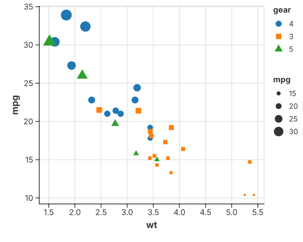<p align="center">Grid Lines</p></td>
        <td>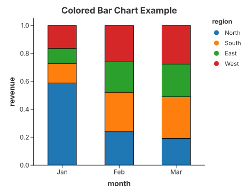<p align="center">Stacked Bar Chart</p></td>
        <td>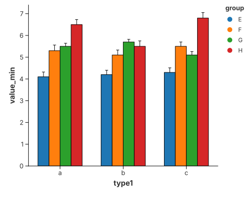<p align="center">Grouped Bar With Errorbar</p></td>
        <td>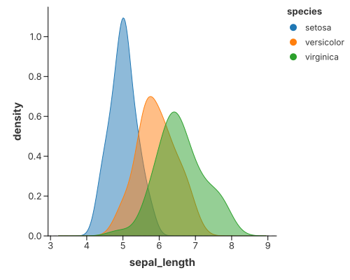<p align="center">Density</p></td>
        <td>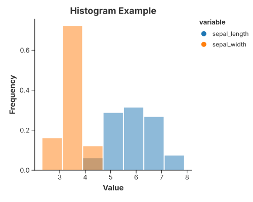<p align="center">Histogram</p></td>
    </tr>
    <tr>
        <td>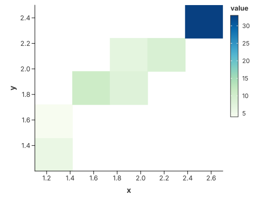<p align="center">Heatmap (continuous)</p></td>
        <td>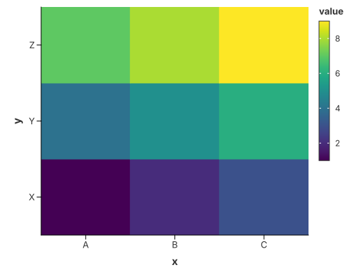<p align="center">Heatmap</p></td>
        <td>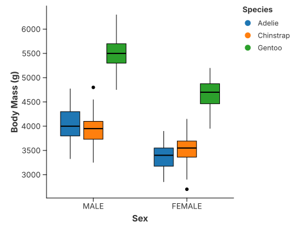<p align="center">Grouped Boxplot</p></td>
        <td>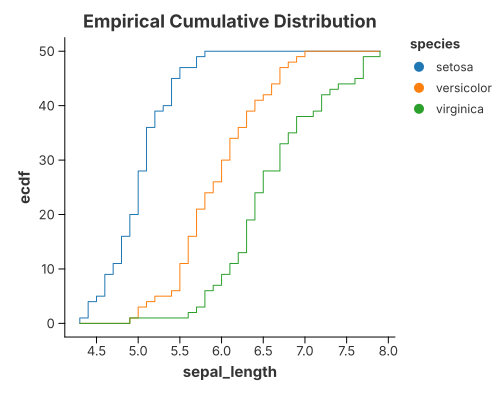<p align="center">Cumulative Frequency</p></td>
        <td>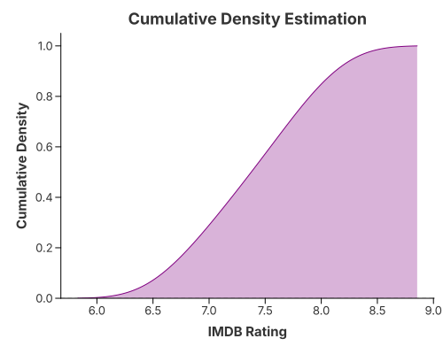<p align="center">Distribution</p></td>
    </tr>
    <tr>
        <td>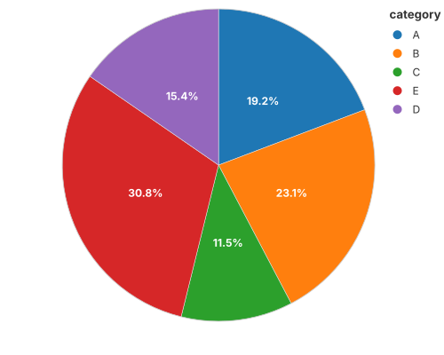<p align="center">Pie</p></td>
        <td>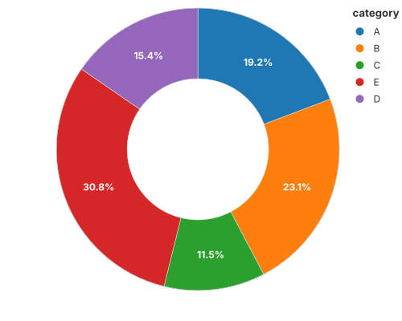<p align="center">Donut</p></td>
        <td>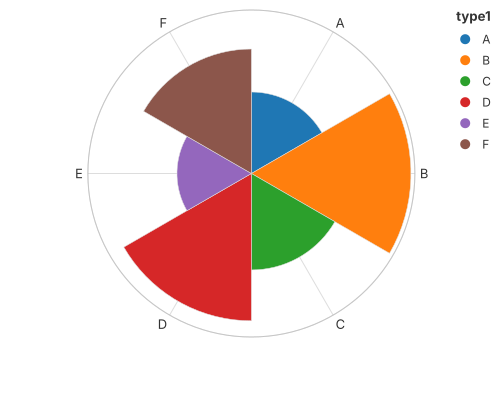<p align="center">Rose</p></td>
        <td>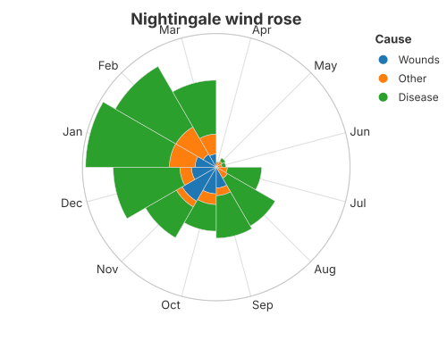<p align="center">Nightingale</p></td>
        <td>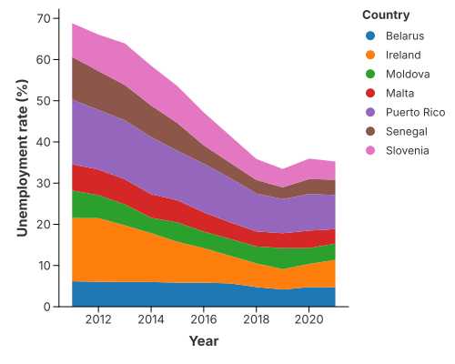<p align="center">Simple Stack Area</p></td>
    </tr>
    <tr>
        <td>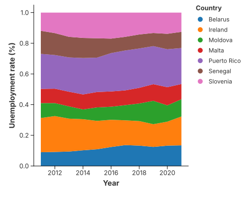<p align="center">Normalized Stacked Area</p></td>
        <td>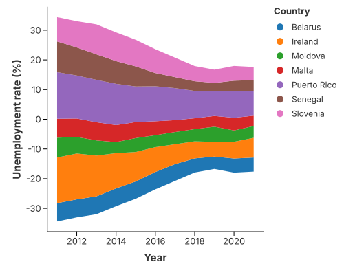<p align="center">Steamgraph</p></td>
        <td>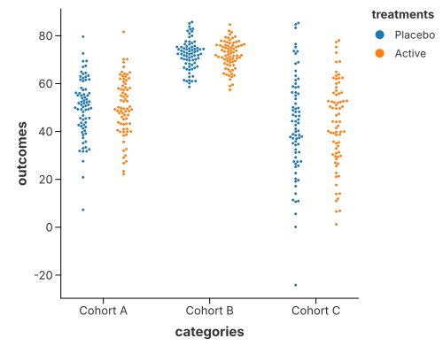<p align="center">Beeswarm</p></td>
        <td>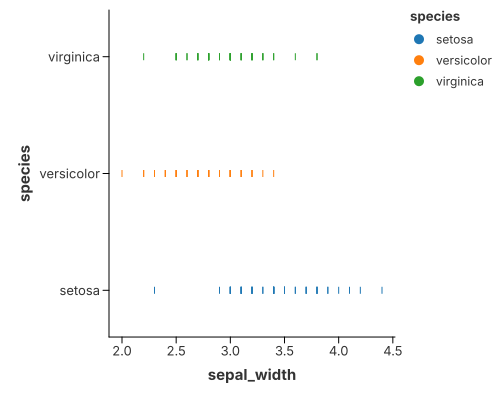<p align="center">Strip</p></td>
        <td>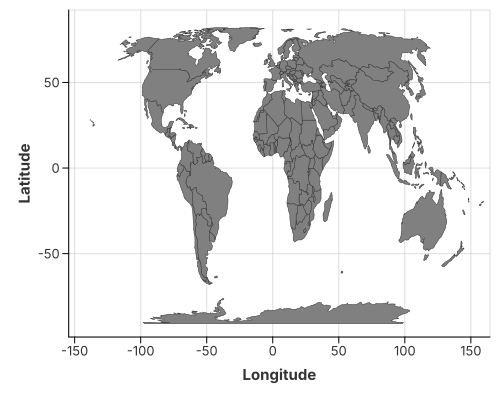<p align="center">Geo Chart</p></td>
    </tr>
    <tr>
        <td>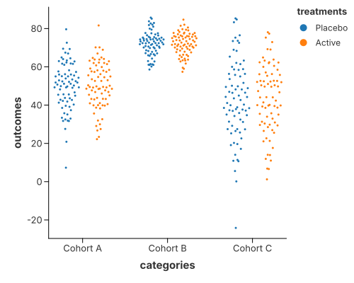<p align="center">Quasirandom</p></td>
        <td>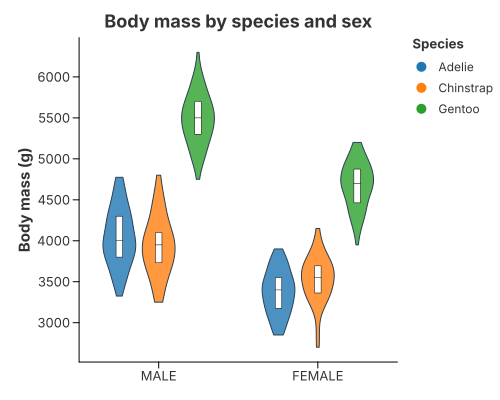<p align="center">Grouped Violin</p></td>
        <td>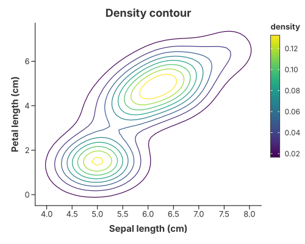<p align="center">Density Contour</p></td>
        <td>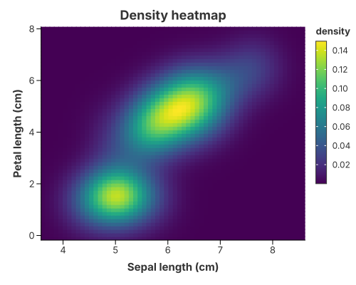<p align="center">Density Heatmap</p></td>
        <td>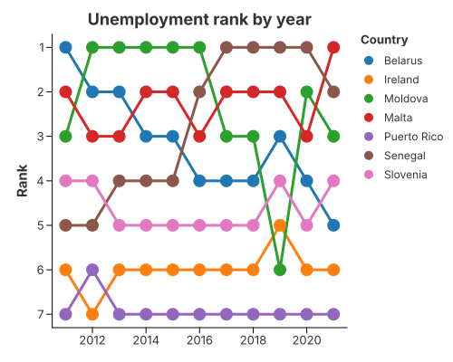<p align="center">Bump Chart</p></td>
    </tr>
    <tr>
        <td>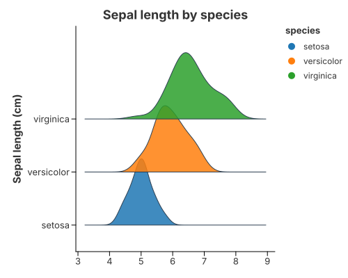<p align="center">Ridgeline</p></td>
        <td>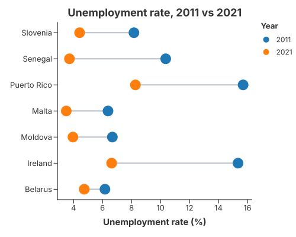<p align="center">Dumbbell</p></td>
        <td>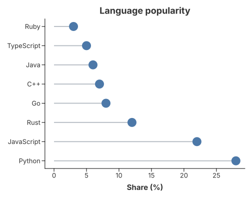<p align="center">Lollipop</p></td>
        <td>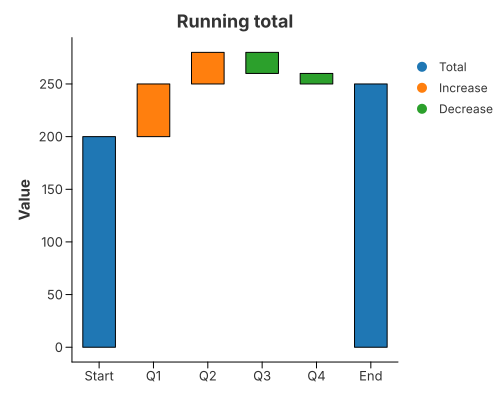<p align="center">Waterfall</p></td>
        <td>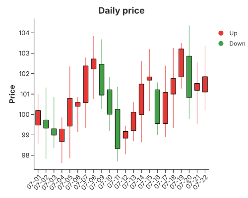<p align="center">Candlestick</p></td>
    </tr>
    <tr>
        <td>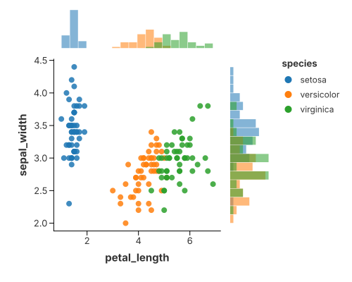<p align="center">Composition</p></td>
        <td>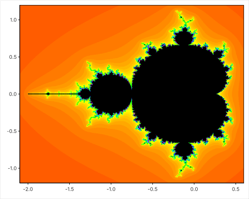<p align="center">Mandelbrot</p></td>
        <td>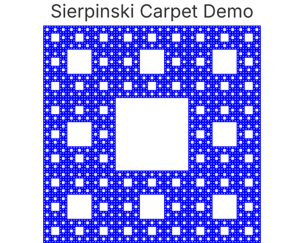<p align="center">Sierpinski</p></td>
    </tr>
</table>

## Quick start

Four ways to draw the same scatter plot from the same six-row [`points.csv`](assets/points.csv). Every path shares the same validator, lowering, and renderer.

| Surface | Install |
| --- | --- |
| Rust library | `cargo add charton` |
| Command line | `cargo install charton-cli` |
| Nushell plugin | `cargo install nu_plugin_charton` |
| MCP server | included in `charton-cli` |

### Rust library

```rust
use charton::prelude::*;

let x = vec![1.0, 2.0, 3.0, 4.0, 5.0, 6.0];
let y = vec![2.1, 3.2, 3.8, 5.1, 5.9, 7.2];

chart!(x, y)?
    .mark_point()?
    .encode((alt::x("x"), alt::y("y")))?
    .save("scatter.svg")?;
```

The `chart!` macro is the shortest path. For production pipelines, use `Chart::build` with a `Dataset` or a Polars `DataFrame` — see [From macros to production API](#from-macros-to-production-api). → [API docs](https://docs.rs/charton)

### Command line

```sh
charton plot points.csv --mark point --x x --y y -o scatter.svg
```

A single static binary with `plot`, `render`, `validate`, and `schema`. It reads CSV, TSV, NDJSON, or stdin — no Rust toolchain, Node, or Python. → [CLI README](charton-cli/README.md)

### Nushell plugin

```nu
open points.csv | charton point -x x -y y -o scatter.svg
```

Register the plugin once with `plugin add`, then load it with `plugin use charton`. → [Plugin README](nu_plugin_charton/README.md)

### MCP server

```sh
charton mcp --root ./data
```

An agent then calls `render_spec`:

```json
{"method": "tools/call", "params": {"name": "render_spec", "arguments": {
  "spec": {"data": {"url": "points.csv"}, "mark": "point",
           "encoding": {"x": {"field": "x"}, "y": {"field": "y"}}}}}}
```

Seven tools let an agent profile data, write a spec, validate it, and render it — without running generated code. → [MCP reference](charton-cli/README.md#the-mcp-server) · [Design chapter](docs/src/getting_started/mcp.md)

The CLI, the Nushell plugin, and the MCP server all speak the same JSON chart document — a Vega-Lite v5 subset described in the [spec guide](docs/src/spec/index.md).

## The Rust library

The quick start above shows the smallest possible chart. The rest of this section covers the Rust API in more depth.

### Feature flags

Enable only what you need:

```toml
[dependencies]
charton = "0.9"                                            # Standard (Single-threaded + SVG export)
charton = { version = "0.9", features = ["png"] }          # Pure Headless Raster Renderer (CPU only)
charton = { version = "0.9", features = ["pdf"] }          # Export charts to PDF format
charton = { version = "0.9", features = ["wgpu", "png"] }  # Local Desktop with GPU acceleration + PNG export
charton = { version = "0.9", features = ["wgpu"] }         # Web Browsers (WebAssembly/Wasm target)
charton = { version = "0.9", features = ["parallel"] }     # Multi-threaded data processing (Rayon)
charton = { version = "0.9", features = ["geo"] }          # Enable geospatial coordinate support
charton = { version = "0.9", features = ["spec"] }         # JSON chart documents (the dialect the CLI/MCP speak)
charton = { version = "0.9", features = ["arrow"] }        # Apache Arrow RecordBatch ingestion
```

### From macros to production API
While the `chart!` macro is a convenient syntactic sugar for rapid prototyping and simple scripts, the underlying `Chart::build` API is recommended for production environments where explicit data handling is required.

#### 1. Professional Build API
For complex applications, use `Chart::build` to gain full control over the `Dataset` lifecycle.

```rust
let ds = Dataset::new()
    .with_column("x", x)?
    .with_column("y", y)?;

Chart::build(ds)? // Equivalent to chart!(ds)?
    .mark_point()?
    .encode((alt::x("x"), alt::y("y")))?
    .save("scatter.svg")?;
```

> **Tip**: Use `add_column` instead if you need to add columns dynamically within loops or conditional logic.

#### 2. Polars Integration
For Polars users, Charton provides the `load_polars_df!` macro to seamlessly convert a `DataFrame` into a Charton-ready `Dataset`.

```rust
use polars::prelude::*;

let df = df![
    "x" => vec![1.0, 2.0, 3.0, 4.0, 5.0, 6.0],
    "y" => vec![2.1, 3.2, 3.8, 5.1, 5.9, 7.2]
]?;

// Efficiently convert Polars DataFrame to Charton Dataset
let ds = load_polars_df!(df)?;

Chart::build(ds)? // Equivalent to chart!(ds)?
    .mark_point()?
    .encode((alt::x("x"), alt::y("y")))?
    .save("scatter.svg")?;
```

**Compatibility Note**: Charton uses versioned macros to handle Polars' rapid API evolutions. Versions below 0.44 are no longer supported. The standard macro is tested against Polars 0.53, 0.54, and 0.55.

| Polars Version           | Macro to Use               | Status            |
|:-------------------------|:---------------------------|:------------------|
| 0.53+ (incl. 0.54/0.55)  | `load_polars_df!(df)?`     | Latest (Standard) |
| 0.44 - 0.52              | `load_polars_v44_52!(df)?` | Legacy Support    |
| < 0.44                   | N/A                        | Unsupported       |

## Layered Grammar
Inspired by the Grammar of Graphics (as seen in `ggplot2` and `Altair`), Charton replaces rigid templates with a modular, layer-based system. Visualizations are constructed by stacking atomic marks, offering infinite flexibility beyond fixed chart types.

```rust
// Create individual layers
let line = chart!(x, y)?
    .mark_line()?
    .encode((alt::x("x"), alt::y("y")))?;

let point = chart!(x, y)?
    .mark_point()?
    .encode((alt::x("x"), alt::y("y")))?;

// Combine into a composite chart
line.and(point).save("layered.svg")?;
```

## Faceting Support
Now supporting multi-panel faceting (`wrap` and `grid` layouts), enabling you to easily split and compare complex datasets across coordinated subplots.

<p align="center"> 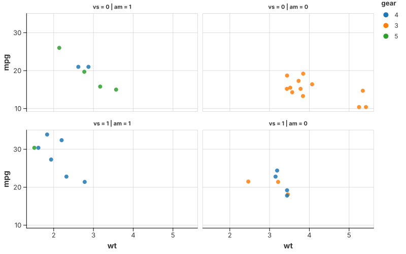 </p>

## Desktop GUI Integration
Charton can render directly into native desktop applications via its GPU-accelerated backend. Below is a real-time system telemetry dashboard built with Charton and egui, demonstrating live CPU, memory, swap, and network monitoring with per-core load distribution:

<p align="center"> 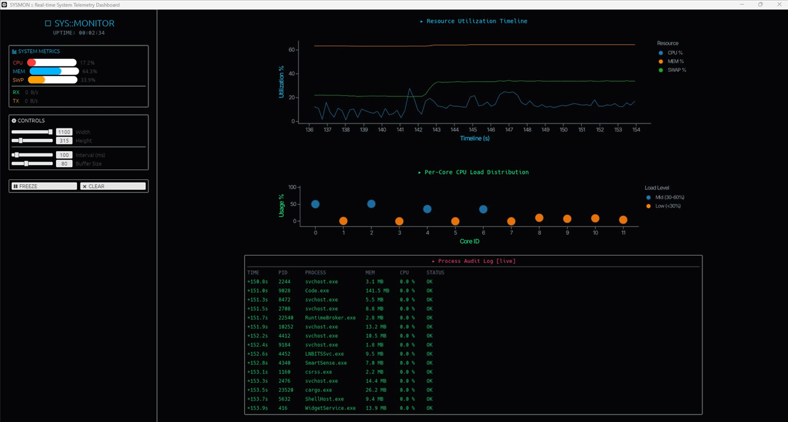 </p>

Charton offers two integration paths for GUI applications: `render_to_surface` for zero-copy GPU rendering (ideal for 60 FPS game loops where wgpu versions align), or the standalone `WgpuRenderer` that manages its own wgpu instance and returns a pixel buffer — slightly slower but immune to wgpu version conflicts between crates.

## WebAssembly and Frontend
Charton supports WebAssembly and modern web frontend. Below is an interactive demo simulates a 50,000-point Lorenz Attractor at 60 FPS, demonstrating how WebAssembly enables high-performance, real-time data visualization in the browser.

<p align="center"> 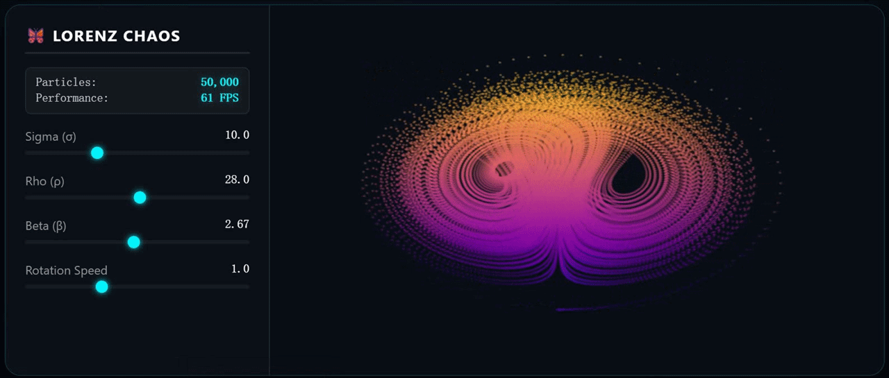 </p>

The SVG it returns is a semantic document: elements carry role classes (`charton-axis`, `charton-mark`, `charton-legend`, …) and identity attributes, so a page stylesheet can restyle a chart — dark mode, brand colors, print — without re-rendering it, and screen readers get the chart's title and description instead of a stream of tick numbers. Exported PDFs carry the equivalent structure as tags. See [Semantic Output](https://wangjiawen2013.github.io/charton/export/semantic_output.html).

## Interactive Notebooks (Jupyter)
Charton integrates with evcxr_jupyter for interactive data exploration. Replacing `.save()` with `.show()` renders SVGs directly within notebook cells:

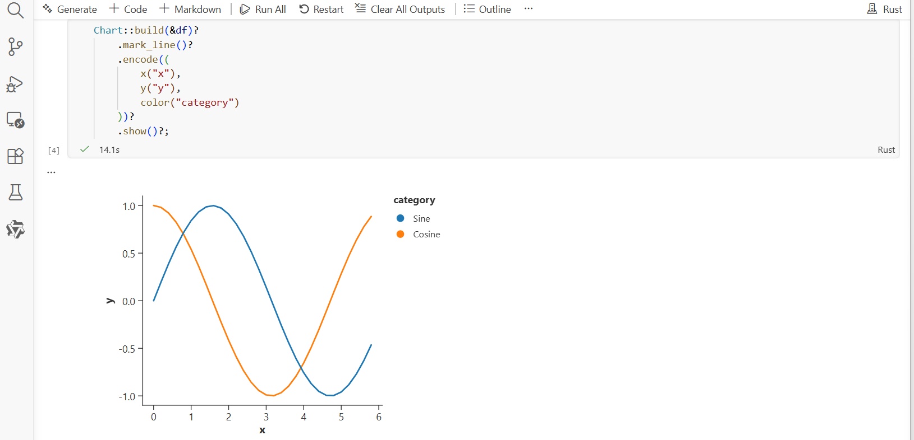

## True Layer Synchronization
Stop fighting with fragile, hard-coded patches. Charton treats scaling as a **Single Source of Truth**, making it possible to combine heterogeneous data sources into one plot while maintaining total mathematical consistency across every mark and axis.
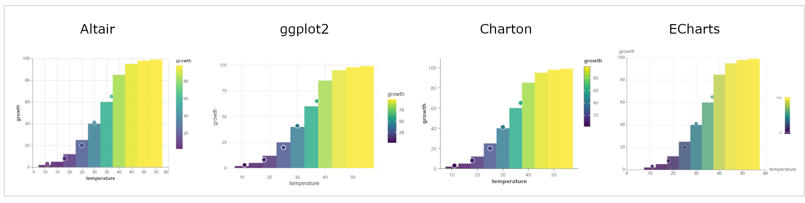
*This figure demonstrates semantic synchronization in Charton. Point samples and bar backgrounds from different data sources are anchored to a unified scale, ensuring absolute color and spatial consistency.*

## Publish Quality
Designed for precision, Charton provides pixel-perfect control over complex marks. Whether it is a multi-layered ErrorBar for biomedical research or a high-density scatter plot for finance, Charton delivers the aesthetic rigor required by top-tier journals.

<table>
    <tr>
        <td>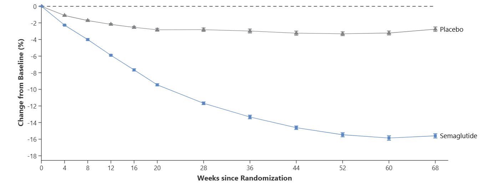<p align="center">NEJM</p></td>
        <td>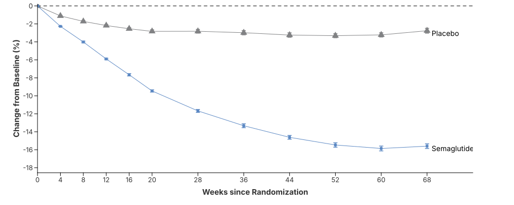<p align="center">Charton</p></td>
    </tr>
</table>

*A reproduction of Figure 1A from the 2021 NEJM landmark study on once-weekly semaglutide for weight management, implemented using Charton.*

## Documentation
Please go to the [Charton Docs](https://wangjiawen2013.github.io/charton) for full documentation.

## Other Rust plotting libraries

[kuva](https://github.com/Psy-Fer/kuva): A scientific plotting library in Rust. 64 plot types, SVG output, optional PNG/PDF backends, and a CLI binary that renders plots directly from the shell.

[charts-rs](https://github.com/vicanso/charts-rs): An ECharts-inspired Rust charting library with multiple chart types, built-in themes, SVG animations, and multi-format export—tailored for dashboards and web-style visualizations rather than scientific plotting.

## License
Charton is licensed under the Apache License 2.0.

## AI Declaration

- AI used: Yes
- Role: Implementation acceleration, test generation, documentation
- Human responsibility: Grammar of Graphics architecture design, code review, maintenance, and all project decisions
