[English](./README.md) | [简体中文](./README_zh.md)

# Charton

**一个面向 Rust、Shell 与 AI Agent 的声明式绘图引擎。**

> *“非常棒的项目。... 作为一个生态系统运行得非常完美。”*
> — [**Ritchie Vink**](https://github.com/pola-rs/polars/issues/25941), Polars 创始人

[](https://crates.io/crates/charton)
[](https://docs.rs/charton)
[](https://github.com/wangjiawen2013/charton/actions)
[](LICENSE)

<p align="center">
  <b>意到图成</b><br>
  <i>标准组件 — 无限图表</i>
</p>

Charton 是一个基于声明式图形语法的绘图引擎。同一张图，可以用 Rust 代码、CLI 命令、Nushell 管道、JSON 图表文档或 MCP 工具调用来写——同一个校验器、同一条构建路径、同一个渲染器。

它的 API 灵感来自 [Altair](https://altair-viz.github.io/) 与图形语法（Grammar of Graphics），并用 [Polars](https://github.com/pola-rs/polars) 做快速数据处理。它也能通过 evcxr_jupyter 在 Notebook 中运行，通过 WebAssembly 在浏览器中运行，并通过 wgpu 在 GPU 上渲染。

## 同一张图，四种写法

同一份六行的 [`points.csv`](assets/points.csv)，同一个简单散点图，四种入口：

<p align="center">
  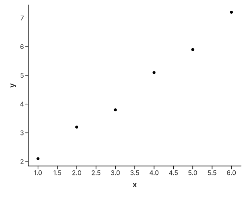
</p>

**Rust 库**

```rust
// df: 从 points.csv 读取的 Polars DataFrame（含 x、y 两列）
Chart::build(load_polars_df!(df)?)?
    .mark_point()?
    .encode((alt::x("x"), alt::y("y")))?
    .save("scatter.svg")?;
```

**命令行**

```sh
charton plot points.csv --mark point --x x --y y -o scatter.svg
```

**Nushell**

```nu
open points.csv | charton point -x x -y y -o scatter.svg
```

**MCP（面向 Agent）**

```json
{"method": "tools/call", "params": {"name": "render_spec", "arguments": {
  "spec": {"data": {"url": "points.csv"}, "mark": "point",
           "encoding": {"x": {"field": "x"}, "y": {"field": "y"}}}}}}
```

四种方式共享同一个校验器、同一条 lower 路径和同一个渲染器。

## 图表画廊

Charton 能画什么？下面每张图都是真实渲染结果，代码见[图表配方库](docs/src/gallery/index.md)。

<table>
    <tr>
        <td>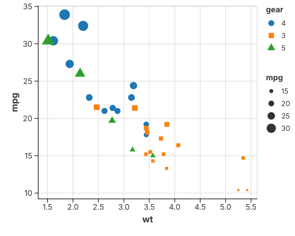<p align="center">Grid Lines</p></td>
        <td>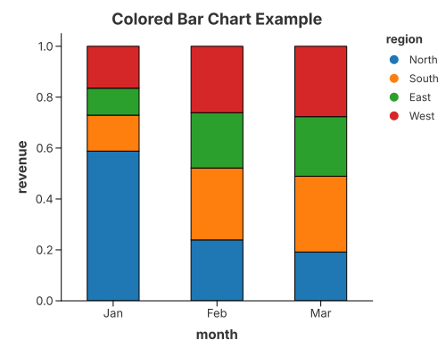<p align="center">Stacked Bar Chart</p></td>
        <td>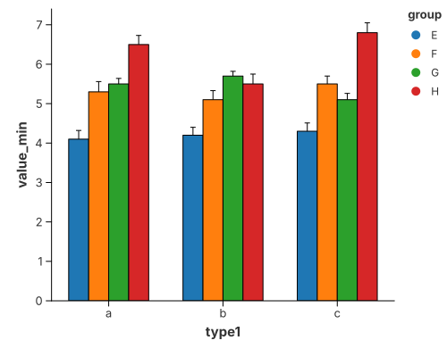<p align="center">Grouped Bar With Errorbar</p></td>
        <td>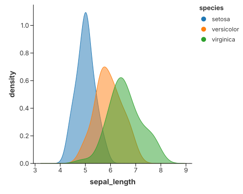<p align="center">Density</p></td>
        <td>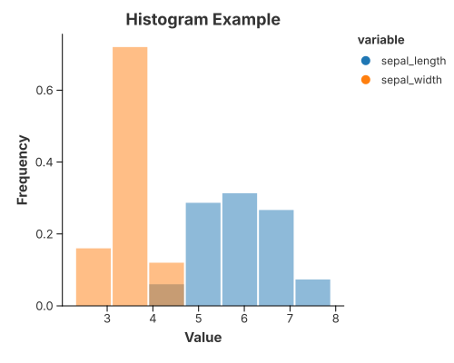<p align="center">Histogram</p></td>
    </tr>
    <tr>
        <td>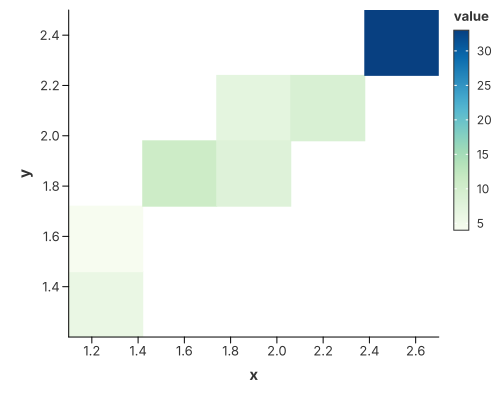<p align="center">连续热力图</p></td>
        <td>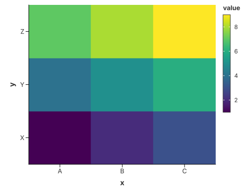<p align="center">Heatmap</p></td>
        <td>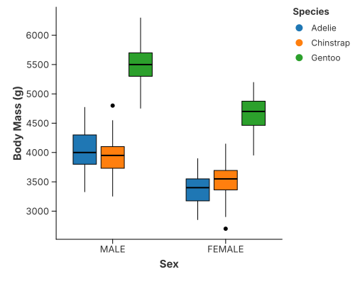<p align="center">Grouped Boxplot</p></td>
        <td>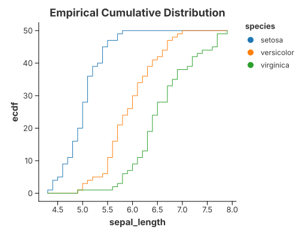<p align="center">Cumulative Frequency</p></td>
        <td>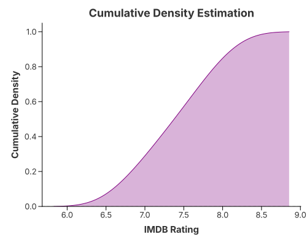<p align="center">Distribution</p></td>
    </tr>
    <tr>
        <td>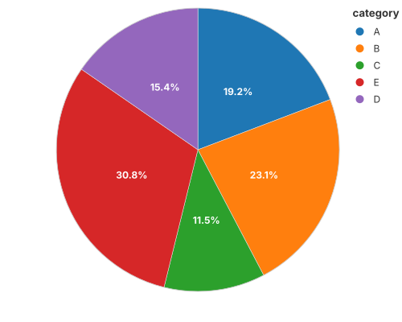<p align="center">Pie</p></td>
        <td>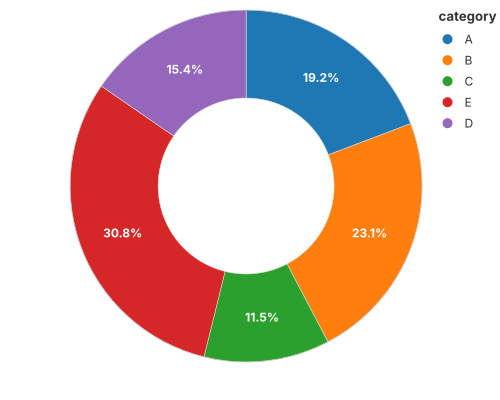<p align="center">Donut</p></td>
        <td>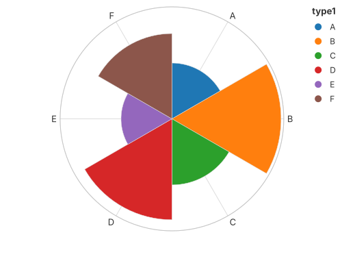<p align="center">Rose</p></td>
        <td>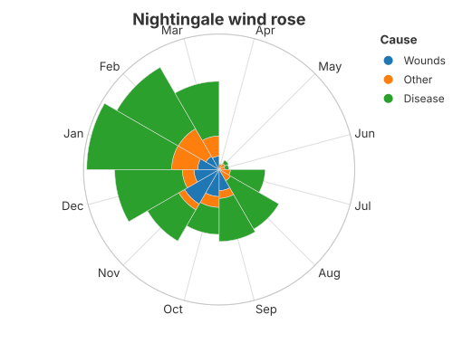<p align="center">Nightingale</p></td>
        <td>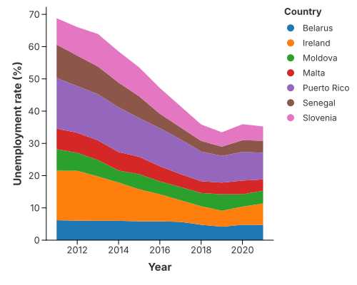<p align="center">Simple Stack Area</p></td>
    </tr>
    <tr>
        <td>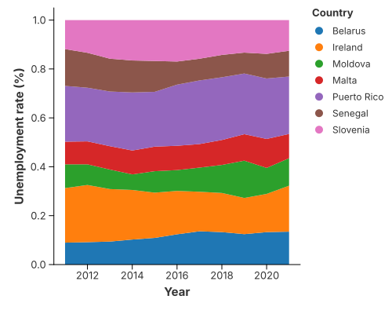<p align="center">Normalized Stacked Area</p></td>
        <td>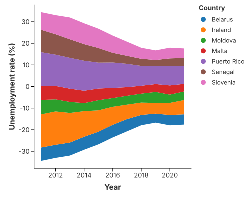<p align="center">Steamgraph</p></td>
        <td>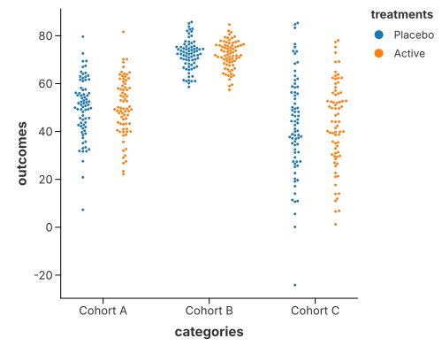<p align="center">Beeswarm</p></td>
        <td>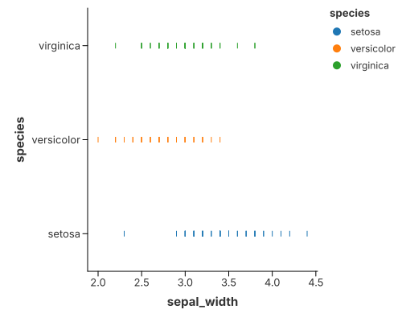<p align="center">Strip</p></td>
        <td>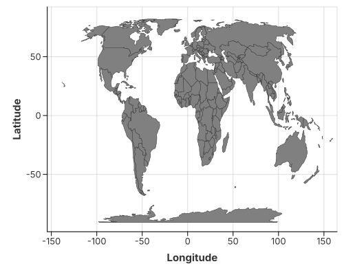<p align="center">Geo Chart</p></td>
    </tr>
    <tr>
        <td>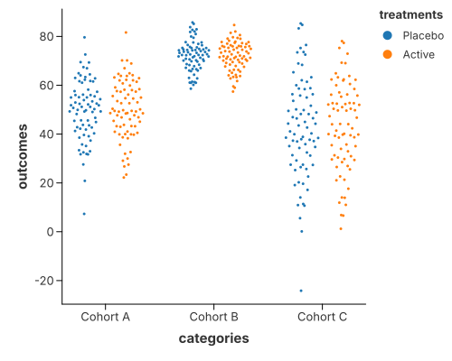<p align="center">Quasirandom</p></td>
        <td>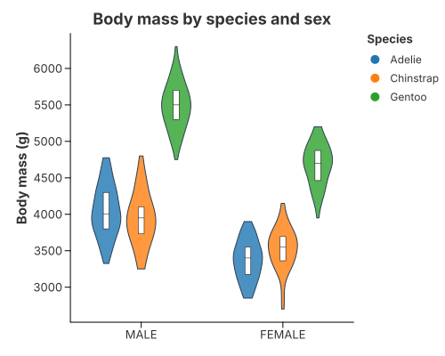<p align="center">Grouped Violin</p></td>
        <td>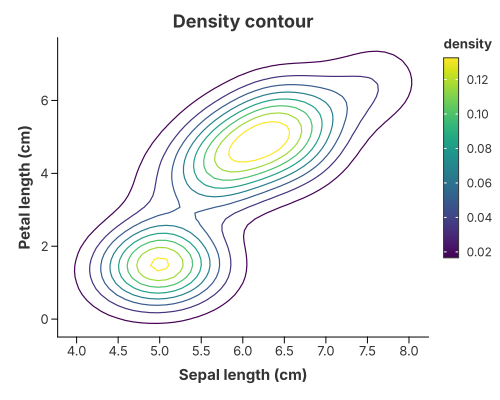<p align="center">Density Contour</p></td>
        <td>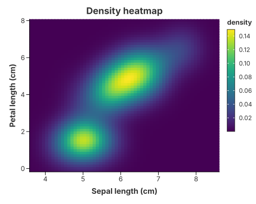<p align="center">Density Heatmap</p></td>
        <td>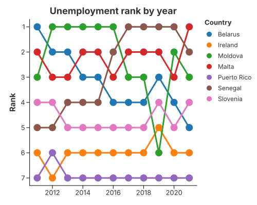<p align="center">Bump Chart</p></td>
    </tr>
    <tr>
        <td>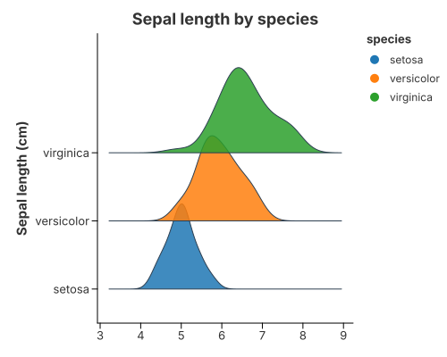<p align="center">Ridgeline</p></td>
        <td>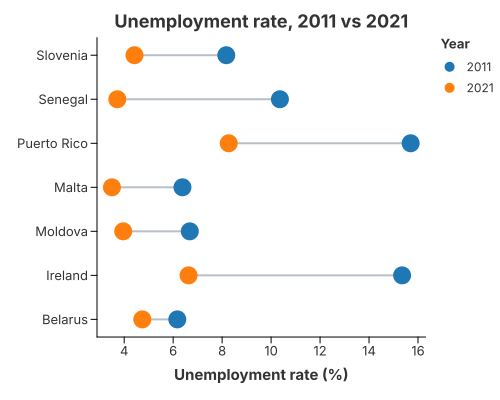<p align="center">Dumbbell</p></td>
        <td>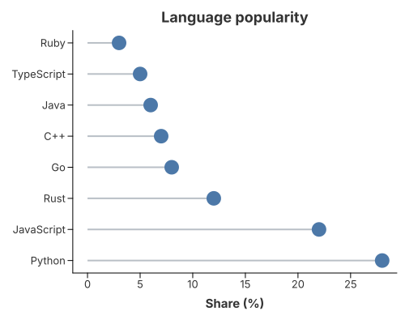<p align="center">Lollipop</p></td>
        <td>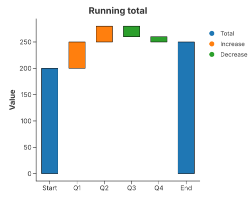<p align="center">Waterfall</p></td>
        <td>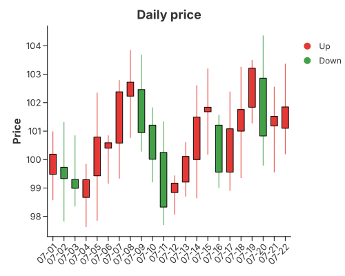<p align="center">Candlestick</p></td>
    </tr>
    <tr>
        <td>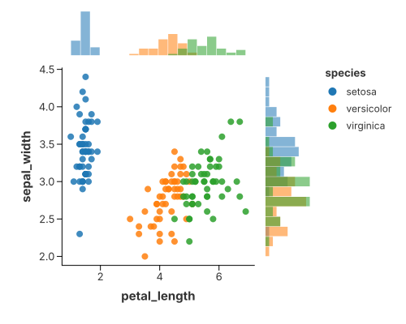<p align="center">Composition</p></td>
        <td>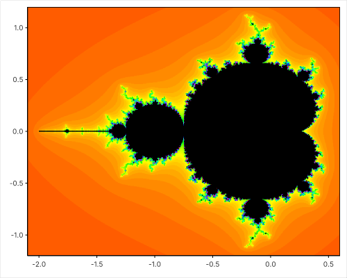<p align="center">Mandelbrot</p></td>
        <td>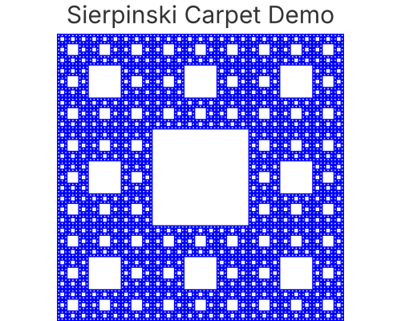<p align="center">Sierpinski</p></td>
    </tr>
</table>

## 入口

Charton 是一个引擎、多个入口。它们共享同一套图表模型、校验器和渲染器。

- **Rust 库** — `charton`，引擎本体。声明式 `Chart` API，支持 Polars/Arrow 输入、SVG/PNG/PDF 导出、Wasm 和 GPU 后端。→ [快速上手](#快速上手) · [API 文档](https://docs.rs/charton)
- **命令行** — `charton-cli`，单个静态二进制，提供 `plot`、`render`、`validate` 和 `schema`。不需要 Rust 工具链、Node 或 Python。→ [CLI README](charton-cli/README.md)
- **Nushell 插件** — `nu_plugin_charton`。把任意管道表格画成图表，终端内联显示或保存为 SVG/PNG。→ [插件 README](nu_plugin_charton/README.md)
- **MCP 服务** — `charton mcp`，包含在 CLI 二进制中。七个工具让 Agent 分析数据、写图表文档、校验并渲染——全程不运行生成的代码。→ [MCP 参考](charton-cli/README.md#the-mcp-server) · [设计章节](docs/src/getting_started/mcp.md)

CLI、Nushell 插件和 MCP 服务使用同一种 JSON 图表文档——Vega-Lite v5 的子集，见[图表文档指南](docs/src/spec/index.md)。

<p align="center">
  
</p>

*Nushell 插件，在终端内联绘图。*

## 安装

### Rust 库

在 `Cargo.toml` 中添加：

```toml
[dependencies]
charton = "0.9"                                            # 标准版 (单线程 + SVG 导出)
charton = { version = "0.9", features = ["png"] }          # 纯后端光栅化渲染（仅 CPU 模式）
charton = { version = "0.9", features = ["pdf"] }          # PDF 格式图表导出
charton = { version = "0.9", features = ["wgpu", "png"] }  # 本地桌面端（GPU 加速 + PNG 导出）
charton = { version = "0.9", features = ["wgpu"] }         # 网页浏览器（WebAssembly/Wasm 目标平台）
charton = { version = "0.9", features = ["parallel"] }     # 多线程数据处理（基于 Rayon）
charton = { version = "0.9", features = ["geo"] }          # 地理坐标支持
charton = { version = "0.9", features = ["spec"] }         # JSON 图表文档（CLI/MCP 使用的方言）
charton = { version = "0.9", features = ["arrow"] }        # Apache Arrow RecordBatch 数据接入
```

### 命令行

```sh
cargo install charton-cli
```

### Nushell 插件

```sh
cargo install nu_plugin_charton
```

然后用 `plugin add` 注册一次，再用 `plugin use charton` 加载。路径与平台说明见[插件 README](nu_plugin_charton/README.md)。

### MCP 服务

MCP 服务包含在 CLI 二进制中：

```sh
charton mcp --root ./data
```

七个工具与协议详见 [MCP 参考](charton-cli/README.md#the-mcp-server)。

## 快速上手
Charton 提供了高级声明式 API。通过一行代码就可以实现可视化：

```rust
use charton::prelude::*;

// 数据：身体指标（身高 vs. 体重）
let height = vec![160.0, 165.0, 170.0, 175.0, 180.0];
let weight = vec![55.0, 62.0, 68.0, 75.0, 82.0];

// 一行代码绘图
chart!(height, weight)?.mark_point()?.encode((alt::x("height"), alt::y("weight")))?.save("out.svg")?;
```

## 从宏到生产级 API
虽然 `chart!` 宏在快速原型设计和书写简单脚本时非常方便，但在需要显式处理数据的生产环境中，建议使用底层的 `Chart::build` API。

### 1. 专业构建 API
对于复杂的应用程序，使用 `Chart::build` 可以完全控制 `Dataset` 的生命周期。

```rust
let ds = Dataset::new()
    .with_column("height", height)?
    .with_column("weight", weight)?;

Chart::build(ds)? // 等价于 chart!(ds)?
    .mark_point()?
    .encode((alt::x("height"), alt::y("weight")))?
    .save("out.svg")?;
```

> **提示**：如果需要在循环或条件逻辑中动态添加列，请使用 `add_column`。

### 2. Polars 集成
针对 Polars 用户，Charton 提供了 `load_polars_df!` 宏，可将 `DataFrame` 转换为 Charton 内部专用的 `Dataset`。

```rust
use polars::prelude::*;

let df = df![
    "height" => vec![160.0, 165.0, 170.0, 175.0, 180.0],
    "weight" => vec![55.0, 62.0, 68.0, 75.0, 82.0]
]?;

// 将 Polars DataFrame 转换为 Charton Dataset
let ds = load_polars_df!(df)?;

Chart::build(ds)? // 等价于 chart!(ds)?
    .mark_point()?
    .encode((alt::x("height"), alt::y("weight")))?
    .save("out.svg")?;
```

**兼容性说明**: 由于 Polars API 变化频繁，Charton 使用带版本标记的宏来处理兼容性。不再支持 0.44 以下的版本。标准宏已针对 Polars 0.53、0.54 和 0.55 进行测试。

| Polars 版本             | 使用的宏                    | 状态          |
|:------------------------|:----------------------------|:--------------|
| 0.53+（含 0.54/0.55）   | `load_polars_df!(df)?`      | 最新（标准）  |
| 0.44 - 0.52             | `load_polars_v44_52!(df)?`  | 旧版支持      |
| < 0.44                  | N/A                         | 不支持        |

## 分层语法
受图形语法（如 `ggplot2` 和 `Altair`）影响，Charton 用模块化的图层系统取代了固定模板。通过组合原子标记（Marks）能构建出丰富的图表类型，极大的提高了作图灵活性。

```rust
// 创建独立图层
let line = chart!(height, weight)?
    .mark_line()?
    .encode((alt::x("height"), alt::y("weight")))?;

let point = chart!(height, weight)?
    .mark_point()?
    .encode((alt::x("height"), alt::y("weight")))?;

// 组合成复合图表
line.and(point).save("layered.svg")?;
```

## 分面作图
现已支持多面板分面（包含`wrap`和`grid`布局），可将复杂数据集拆分到多个联动的子图中，进行直观的对比分析。

<p align="center"> 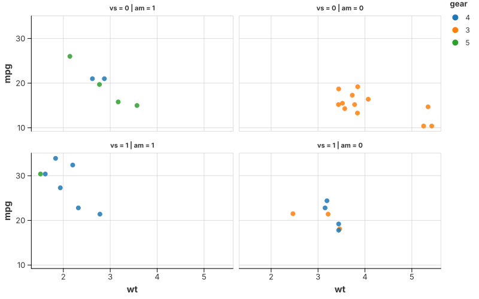 </p>

## 桌面 GUI 集成
Charton 可以通过其 GPU 加速后端直接渲染到原生桌面应用中。下图是一个使用 Charton 和 egui 构建的实时系统遥测仪表板，展示了实时 CPU、内存、Swap 和网络监控，以及每个核心的负载分布：

<p align="center"> 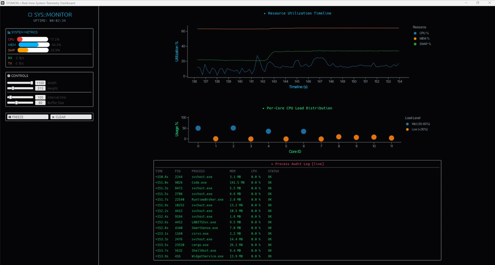 </p>

Charton 为 GUI 应用提供了两种集成路径：`render_to_surface` 用于零拷贝 GPU 渲染（适合 wgpu 版本一致时的 60 FPS 游戏循环），或者独立的 `WgpuRenderer`，它管理自己的 wgpu 实例并返回像素缓冲区——速度稍慢，但不受 crate 之间 wgpu 版本冲突的影响。

## WebAssembly 与前端
Charton 支持 WebAssembly 及现代 Web 前端开发。下面这个示例展示了一个支持实时交互的 50,000 点 Lorenz 吸引子 3D 动力学系统，利用 WASM 技术在浏览器中实现 60 FPS 的超流畅渲染。

<p align="center"> 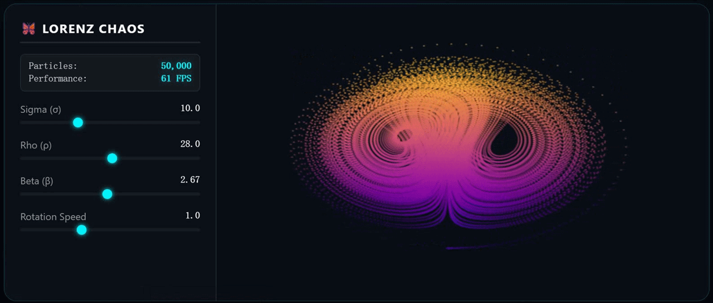 </p>

其返回的 SVG 是一份语义化文档：元素带有角色 class（`charton-axis`、`charton-mark`、`charton-legend` 等）与身份属性，因此页面样式表可以在不重新渲染的前提下重绘图表——深色模式、品牌色、打印样式；屏幕阅读器读到的则是图表标题与描述，而不是一串刻度数字。导出的 PDF 也带有等价的标签结构。详见[语义化输出](https://wangjiawen2013.github.io/charton/export/semantic_output.html)。

## 交互式作图 (Jupyter)
Charton 与 evcxr_jupyter 集成，支持交互式数据探索。将 `.save()` 替换为 `.show()` 即可直接在 jupyter notebook 单元格中显示 SVG：

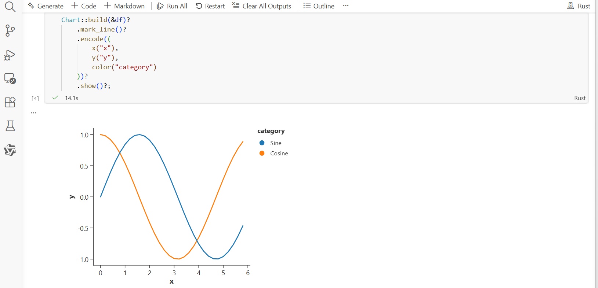

## 原生图层同步
Charton 基于**单一事实来源**处理标度映射，能组合不同来源的数据，并保持所有图表元素与坐标轴的逻辑一致性。

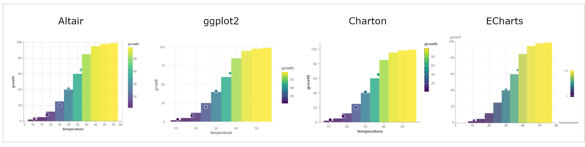

*该图展示了 Charton 中的语义同步。来自不同数据源的点集与条形图被锚定在统一的标度体系下，确保了数据与色彩、空间位置映射关系的精准对齐。*

## 出版级质量
Charton 作图精准，提供对复杂标记的像素级控制。无论是用于生物医学研究的多层误差线（ErrorBar），还是用于金融领域的高密度散点图，Charton 都能提供顶尖期刊所需的审美严谨性。

<table>
    <tr>
        <td>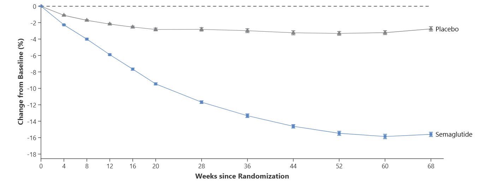<p align="center">NEJM</p></td>
        <td>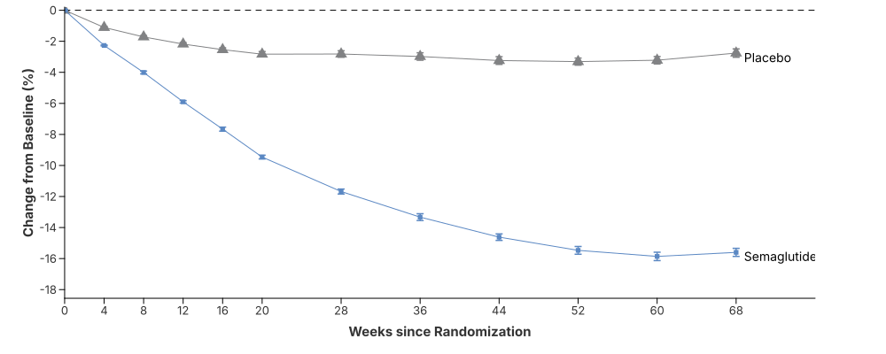<p align="center">Charton</p></td>
    </tr>
</table>

*使用 Charton 复现了 2021 年新英格兰医学杂志上发表的使用减肥药司美格鲁肽进行体重管理的研究论文中的图 1A。*

## 文档
请访问 [Charton Docs](https://wangjiawen2013.github.io/charton) 查看完整文档。

## 其他 Rust 绘图库

[kuva](https://github.com/Psy-Fer/kuva)：一个 Rust 科学绘图库。支持多种图表类型，SVG 输出，可选的 PNG/PDF 后端，以及一个可直接在终端中渲染绘图的 CLI 工具。

[charts-rs](https://github.com/vicanso/charts-rs)： ECharts 风格的 Rust 图表库，支持多种图表类型、内置主题、SVG 动画和多格式导出——更适合仪表盘和 Web 风格可视化，而非科学绘图。

## License
Charton 基于 Apache License 2.0 许可证开源。

## AI 使用声明

- 是否使用 AI：是
- 用途：加速实现、生成测试、撰写文档
- 人工职责：图形语法架构设计、代码审查、项目维护及所有决策