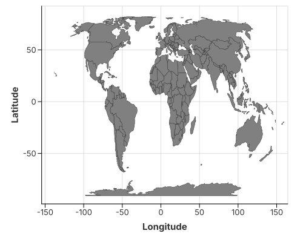

# Geospatial

Map polygons are `mark_polygon` with a `path_group` per region; points and
labels layer on top with the ordinary marks. `CoordSystem::Geo` supplies the
projection; the mark itself is domain-neutral.

GeoJSON polygons with holes keep every ring. `geojson_to_dataset` emits
`_path_id` for the shape and `_ring_id` for each ring, and
`path_group("_path_id").with_subpath("_ring_id")` feeds them to the renderer as
one even-odd path. The inner ring therefore appears as a real hole on every
backend.

## World map



```rust
{{#include ../../../examples/world_map.rs}}
```

## See also

- [Coordinate Systems](../grammar/coordinates.md) — `CoordSystem::Geo` and the
  available projections.
