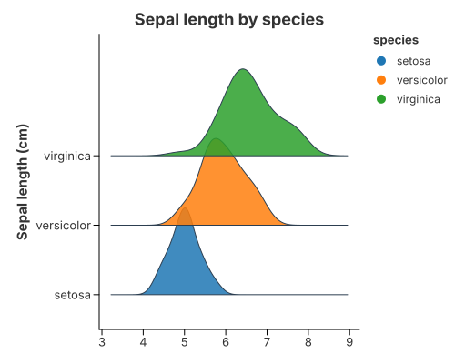

# Composing Your Own

The convenience marks cover the charts people ask for by name. This page is for
everything else: how to assemble the public transforms and the Tier-1 geometries
into a picture that no mark provides.

> Read [Design Rules: Marks, Tiers & Statistical Atoms](../concepts/design_rules.md)
> for the tiers and the thin-recipe rule, and
> [Transforms & Columns](../grammar/transforms.md) for the column each transform
> emits.

## The pattern

A hand-written recipe is always three steps:

1. **stat** — a `transform_*` **replaces** the table with derived columns;
2. **geom** — a Tier-1 mark draws those columns;
3. **encode** — map the emitted columns to channels (`x`, `y`, `path_group`,
   `color`).

Every convenience mark is exactly this, and its expansion is written out on its
own page under **"Built from the primitives"**:

| Mark | Hand-written version |
|---|---|
| `mark_density` | [1-D Density → Built from the primitives](density_1d.md#built-from-the-primitives) |
| `mark_violin` | [Violin → Built from the primitives](violin.md#built-from-the-primitives) |
| `mark_density` (`cumulative`) | [Cumulative Density → Built from the primitives](cumulative_density.md#built-from-the-primitives) |
| `mark_contour` | [Contour Plots → Built from the primitives](contours.md#built-from-the-primitives) |

## A new composition: the mirrored density

Recombining means choosing a different *geom* for the same *stat* — or the other
way round. `mark_violin` pairs `transform_density` with `transform_band` (a
mirrored polygon). Pair the same density with `mark_area` and
`stack: "center"` instead and you get a **mirrored density**: each curve is drawn
from `-density / 2` to `+density / 2`. This is the Vega-Lite
`density + area + stack` recipe, and it is the right choice when you want the
untrimmed tail rather than the data-bounded violin.

```rust
{{#include ../../../examples/density_mirror.rs}}
```

## A ridgeline from a half-band

A **ridgeline** stacks one density per category, each sitting on its baseline and
overlapping the one above. `mark_violin` uses a *symmetric* band;
`transform_band(…).with_side(BandSide::Right)` keeps only one bank, so the flat
edge of the polygon is the baseline. `with_overlap(2.5)` grows each ridge past
its lane so the densities overlap, and `coord_flip` puts the value on the
horizontal axis and the density bulge on the vertical one.



```rust
{{#include ../../../examples/ridge.rs}}
```

The pieces are all public: `transform_density` estimates one curve per category,
`transform_band` mirrors it into a polygon and `mark_polygon` fills it. None of
this is ridge-specific: `with_side(BandSide::Both)` is the full violin, a
one-sided band is a half violin, and `with_overlap` is also how violins overlap.
See
[The firewall](../concepts/design_rules.md#the-firewall-a-mark-must-change-a-cell)
for why a ridgeline is a recipe rather than a mark.

One practical note: because a ridge grows past its lane, the category axis is
trained from the numeric positions the band actually emits. The axis expands
to include them, so the example needs no hand-written `with_expansion`; use it
only when you want more (or less) breathing room than the automatic fit.

## Choosing the geometry

For the marks that turn rows into shapes, the geometry differs along three axes:
how it is ordered, how it is grouped, and whether it is closed and filled.

| Geometry | One row is | Connects rows? | Order | Grouped by | Closed? | Filled? |
|---|---|---|---|---|---|---|
| `mark_line` | a point on a series | yes | sorted by x | `color` | no | no |
| `mark_path` | a vertex of a polyline | yes | **row order** | `path_group` (+ subpath) | no | no |
| `mark_polygon` | a vertex of a ring | yes | **row order** | `path_group` (+ subpath) | **yes** | **even-odd** |
| `mark_tick` | one short segment | **no** | — | — | — | — |
| `mark_rect` | one axis-aligned cell | **no** | — | `color` (value) | cell | **yes** |

A path group may contain several subpaths: `path_group(...).with_subpath(...)`
separates an outer ring from its holes (or the parts of a multi-line). Closed
paths use even-odd filling, so an inner ring is a real hole.

Two families are at work:

- **Connected sequences** (`mark_line`, `mark_path`, `mark_polygon`) turn each
  row into a vertex and join the vertices. The questions are order, grouping and
  closure.
- **Per-row glyphs** (`mark_tick`, `mark_rect`) never join rows. `mark_tick` is a
  fixed-pixel positional mark; `mark_rect` is an axis-aligned, binned value cell.

So a contour (`mark_path`, open) and a violin (`mark_polygon`, closed) are the
open and closed forms of the same path geometry. A rug mark (`mark_tick`) and a
heatmap cell (`mark_rect`) look like rectangles at the primitive layer, but they
answer different data questions and are not interchangeable.

See
[Connecting the dots](../grammar/marks.md#connecting-the-dots-line-path-and-polygon)
and [The five geometries side by side](../grammar/marks.md#the-five-geometries-side-by-side).

## When to stop composing

If you keep rebuilding the same picture, that is the signal to add a mark — but
only if it passes the
[promotion checklist](../concepts/design_rules.md). A *split* violin is a
parameter of `mark_violin`; a *raincloud* is a stack of layers, so it stays a
recipe. The rule of thumb: a name that is a geometry/statistic **atom** (violin,
contour) can become a mark; a name that is a **metaphor for a whole picture**
(raincloud, waterfall) is a composition.

## See also

- [Transforms & Columns](../grammar/transforms.md) — the full column contract.
- [Marks & Geometries](../grammar/marks.md) — the Tier-1 vocabulary
  (`mark_point`, `mark_line`, `mark_path`, `mark_polygon`, `mark_tick`,
  `mark_rect`, …).
- [Design Rules](../concepts/design_rules.md) — tiers, the thin-recipe rule, and
  when a new mark is justified.
