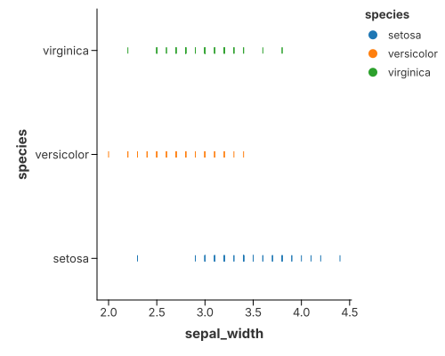
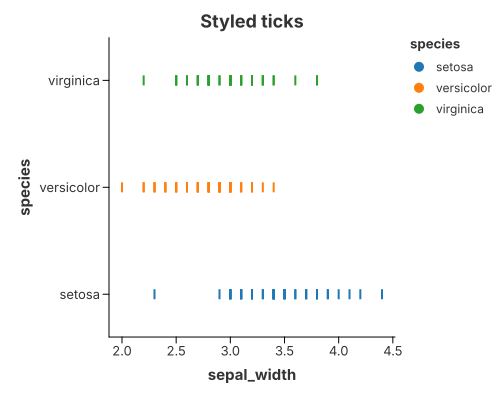

# Strip & Rug Plots

A tick is a short line; many ticks along an axis read as density.

## Strip Plot
The following example uses tick marks to show the distribution of sepal width in the Iris dataset. By adding a y field (categorical data), a strip plot is created to show the distribution of sepal width across different species.

```rust
{{#include ../../../examples/strip.rs}}
```



When there is only one category, or the colour encoding is absent, it degenerates to a "rug" of lines along the bottom.

You can precisely control the visual weight of the ticks using configure_tick. This is useful for balancing the "density" look of the chart.



```rust
{{#include ../../../examples/tick_style.rs}}
```

## Significance and Usage

A tick is a **per-row glyph**, not a connected geometry. Each row becomes one
short segment whose length (`band_size`) and thickness are measured in pixels;
rows are never joined, sorted or filled. That is what separates it from
`mark_line`, `mark_path` and `mark_polygon`.

- Compared with `mark_point`: a point is a shape with a data-driven size; a tick
  is a fixed linear mark that emphasizes positional density. Overlapping ticks
  create a "barcode" effect that reveals where values cluster.
- Compared with `mark_rect`: a tick has no data-space width and no value colour;
  it is a one-dimensional positional glyph, not a heatmap cell.
- Configure it with `configure_tick`: `with_band_size` controls the length,
  `with_thickness` the stroke width, and `with_color` / `with_opacity` the paint.

Common use cases:

1. **Rug plots** — along the edge of a scatter plot or histogram to show the
   marginal distribution.
2. **Strip plots** — an alternative to box plots for small/medium samples, where
   every observation should remain visible.
3. **Dense positional displays** — drawing simple quads is extremely efficient,
   so ticks scale to millions of observations better than complex shapes.

See also [Point Mark](../grammar/marks.md#point-mark-mark_point) and
[The five geometries](../grammar/marks.md#the-five-geometries-side-by-side).