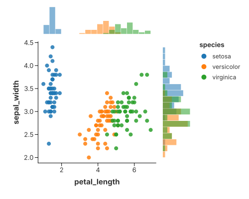
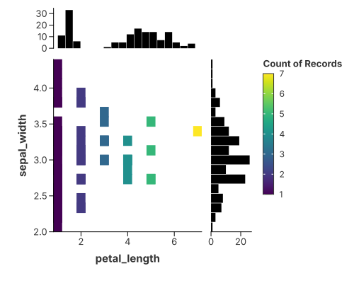
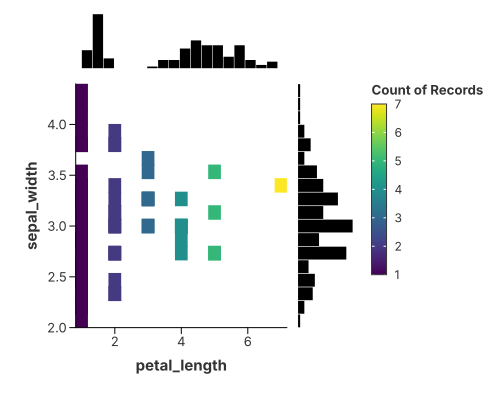
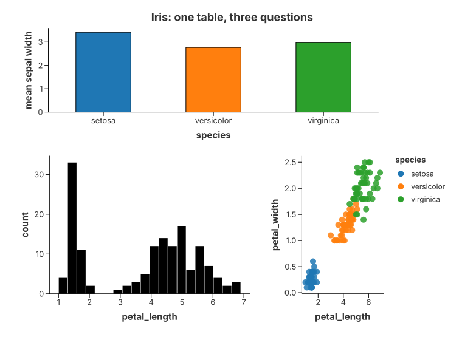
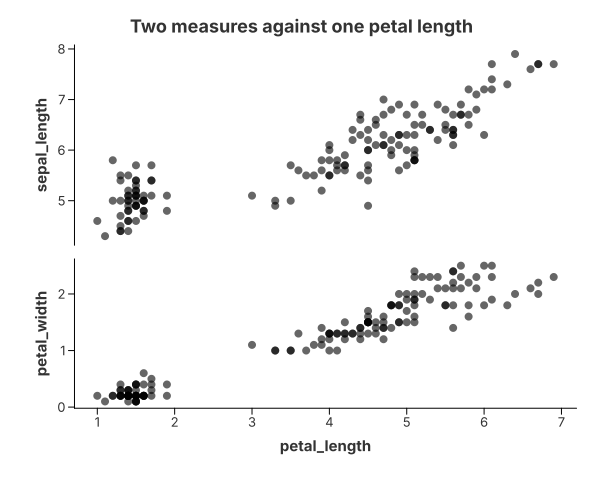
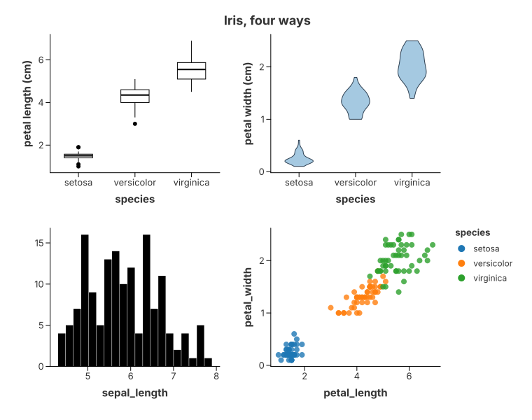

# Composition: Several Views on One Page

Faceting slices **one** chart into panels. Composition places **several** charts
on one page. Both divide a canvas, so they are easy to confuse:

| | Facet | Composition |
| --- | --- | --- |
| Input | one grammar, one dataset, split by a field | any number of independent views |
| Panels | peers, **equal by construction** | cells, **deliberately unequal** |
| Axis space | tracks **inside** the grid | each view brings its own, then shares |
| Statistics | re-run **per panel** | each view summarises the whole table |
| Sizes | one panel size for all | `Fixed(px)` or `Fill(weight)` per track |

**Same picture over subsets of the rows → facet. Different pictures on one page →
composition.**

## How to read this chapter

1. **[Design principles](#design-principles)** — the six decisions the whole rest
   of the chapter derives from. If you read nothing else, read this.
2. **[Tutorial](#tutorial-from-two-charts-to-a-marginal-plot)** — build a marginal
   plot in six steps, one setting at a time, and see what each one buys.
3. **Reference** — [which constructor to call](#which-constructor-to-call), then
   the [model](#the-model-tracks-cells-views), [sizing](#sizing-fixed-versus-fill),
   [alignment](#lining-cells-up-align) and [legend](#where-the-legend-goes) rules,
   each in one place.
4. **[Recipes](#recipe-a-scatter-with-marginal-histograms)** — six complete figures,
   each a runnable file.

## Design principles

Seven decisions produce the whole design. Each one names what it rejects, because
that is what makes it a decision rather than a description.

### 1. A page arranges pictures; it never draws data

Composition adds **no mark and no statistic**. A scatter with marginal histograms is
three ordinary charts — `mark_point` and two `mark_hist` — whose layout is decided
here. There is no `mark_marginal`, no `jointplot`, no chart type this module knows
about.

*What it buys:* every mark, transform, scale, theme and accessibility feature you
already know works inside a cell, unchanged and untested-again.
*What it rejects:* a monolithic "marginal plot" API, which would have to re-implement
axes, scales and guides for every combination of main mark and strip mark.

### 2. Tracks, not a matrix of equal rectangles

A page is a grid of **tracks**: one width per column, one height per row. That is why
a strip in the top row and the scatter below it start at the same x — there is one
column, so there is one answer. The [facet grid](views.md) already works this way,
for the same reason.

*What it buys:* alignment is a property of the layout, not something you nudge into
place. A second column can have its own width without disturbing the first.
*What it rejects:* absolute per-cell rectangles (matplotlib's `add_axes`), where
nothing lines up unless you compute every number yourself.

### 3. Two sizes, and only two

A track is `TrackSize::fixed(px)` or `TrackSize::fill(weight)`: exact pixels, or a
share of what the fixed tracks left over. That is CSS grid's `px` / `1fr`.

*What it buys:* one linear solve, and a page that responds to its canvas — the strip
stays 60px while the main view takes the rest.
*What it rejects:* content-based sizing (`auto`, `constrained_layout`). It needs the
measured width of every tick label and legend, then the tracks have to be solved
again; `Fixed` covers the case that matters, at a fraction of the machinery.

### 4. Measure, then place

A view is asked where its data lands **in the box it will get**. The page then writes
its decisions down — this rectangle, this scale, this legend is mine now — and the
view draws. One pass, no iteration.

*What it buys:* what was measured is exactly what is drawn, so alignment cannot
"nearly" work. It also means a page never has to know what a chart is.
*What it rejects:* re-flowing the page after the fact (the classic
"solve → draw → notice it does not fit → solve again" loop), and any renderer that
takes an origin argument.

### 5. Align by data, and intersect — never unite

The rectangle cells share is the **intersection** of their own data rectangles: the
latest start and the earliest end.

*What it buys:* alignment can only shrink a panel inside the box its owner already
had. It can never push a cell's axis labels over its neighbour's data, so a pinned
page is never worse than an unaligned one.
*What it rejects:* stretching every panel to the union — the visually obvious choice,
and the one that overflows whenever the cells' furniture differs.

### 6. Nothing is guessed silently

Every number that decides the picture is either yours, or derives from a rule stated
once. Where a rule does choose — which cell's legend the page draws, which cell a
parent aligns — the result is the largest cell, and the method to override it exists
(`with_legend_from`). A named cell is a promise, not a hint: if it has nothing to
give, the page draws no legend rather than quietly picking another.

*What it buys:* a figure never changes because a cell grew a longer tick label.
*What it rejects:* heuristics that are "usually right" and invisible when they are
not.

### 7. One setting per behaviour

Where two settings would mean the same thing, there is only one. `Align` carries
"line up by data" *and* "how much" together, because "flush bounds with no alignment"
is the same picture as "placed by canvas". A page's legend position is its theme's
legend position, so there is one field and two spellings. There is no
`Composition::new()`, because a page *is* its layout and every constructor names one.

*What it buys:* you cannot configure something and get nothing. Every knob in the API
is consulted, so the mental model is the API.
*What it rejects:* convenience setters that silently do nothing in the wrong
configuration.

## Tutorial: from two charts to a marginal plot

Seven small steps, one setting each. Every step names what goes wrong without it, so
the settings stop being arbitrary. The three charts are the ones from the recipe at
the end of the chapter; only their layout is shown here.

### Step 1 — a page is a list of views

```rust
Composition::vconcat((top_hist, scatter))
```

Two finished charts, stacked. A composition takes **views**, not data: it never sees
a mark, a scale or a transform. `vconcat` is the one-column shorthand for
`Composition::grid(2, 1)`.

Both rows are `TrackSize::fill(1.0)` by default, so they split the height evenly — the
strip is as tall as the chart it summarises.

### Step 2 — give the strip a fixed track

```rust
    .with_row_height(0, TrackSize::fixed(60.0))   // ←
```

A track is either exact pixels or a share of what is left. Sixty pixels for the
strip, the rest for the scatter. Without it the two shares stay even, and the strip
grows into half the page.

### Step 3 — align the cells by their data

```rust
    .with_align(Align::Each)                      // ←
```

Now the interesting one. By default a cell is placed by its **canvas**, furniture
included — and the strip has no y axis, so its picture *starts* about forty pixels
left of where the scatter's data starts. `Align::Each` places the cells of a column
by their **data rectangle** instead, so the same value lands on the same x in both.
This is what a marginal plot is; everything else is sizing and presentation.

### Step 4 — let the scale follow the rectangle

Nothing to write: `Resolve::Shared` is the default. The cells that share a rectangle
also share the scale in it, so the strip adopts the domain the scatter resolved.

Without it — `with_resolve(Resolve::Independent)` — the rectangles would line up while
the ranges disagreed, and a value in the strip would sit over a different value in the
chart. Sharing is right for a strip; independent is right for two charts that plot
unrelated quantities.

### Step 5 — let the page draw the legend

```rust
    .with_legend_position(LegendPosition::Right)  // ←
```

A legend belongs to the view that declares it, so by default it is drawn inside that
view's own band. In a two-column layout that band falls *between* the scatter and the
right-hand strip. `with_legend_position` moves it to the edge of the page instead, and
the view grows into the band it gave up.

### Step 6 — the second strip turns the row into a grid

```rust
Composition::grid(2, 2)                           // ← was vconcat(..)
    .with_column_width(1, TrackSize::fixed(60.0)) // ← a 60px strip on the right
    .with_row_height(0, TrackSize::fixed(60.0))
    .with_cell(0, 0, top_hist)
    .with_cell(1, 0, scatter)
    .with_cell(1, 1, right_hist)                  // ← (0, 1) stays empty
    .with_align(Align::Each)
    .with_legend_position(LegendPosition::Right)
```

A right-hand strip needs a second column, and a shorthand cannot express that, so this
is where the general constructor appears. The top-right intersection holds no cell on
purpose: that is how the blank corner is expressed, so the top strip stops at the
scatter's right edge instead of running over the right-hand histogram.

Two presentation decisions stay yours, not the page's: the right strip is written
upright and turned with `coord_flip()` (it summarises y, so it runs vertically), and
each strip hides the axis and legend it would otherwise repeat
(`with_show_x_axis(false)`, `with_show_legend(false)`).

### Step 7 — name it

```rust
Composition::marginal(
    scatter,
    Marginals::new().with_top(top_hist).with_right(right_hist),
)
```

The layout you just built is the one everybody builds, so it has a name. Nothing new
happens at this step: `marginal` writes the track sizes, the cells and the alignment
from steps 2, 3 and 6 — and leaves the legend and everything each strip draws to you,
which is why it is a **layout** and not a chart type.

## Vocabulary

The names come from the libraries people already use, so the code reads without a
glossary:

| charton | Comes from | Meaning |
| --- | --- | --- |
| `hconcat` / `vconcat` | Vega-Lite, Altair (`|`, `&`) | views side by side / stacked |
| `with_spacing` / `with_column_spacing` / `with_row_spacing` | Vega-Lite `spacing`, matplotlib `wspace`/`hspace` | gap between tracks |
| `Align::Each` / `All` / `None` | Vega-Lite `bounds` + `align` | share one panel per track / page-wide / nothing |
| `Resolve::Shared` / `Independent` | Vega-Lite `resolve: {scale: …}` | whether the shared rectangle shares its scale |
| `with_column_width` / `with_row_height` | matplotlib `width_ratios` / `height_ratios` | the size of one track |
| `with_width` / `with_height` | Vega-Lite per-view `"width"` / `"height"` | how much room a view asks for |
| `TrackSize::Fixed` / `TrackSize::Fill` | CSS grid `px` / `1fr` | exact pixels / share of the rest |
| `with_cell(row, col, view)` | a table cell (matplotlib's `add_subplot`) | one slot of the grid |
| `with_legend_position(edge)` | `Theme::with_legend_position` | draw a cell's legend on the page edge |
| `with_legend_from(row, col)` | Vega-Lite `resolve: {legend: …}` | name the cell that gives its legend up |
| `marginal(main, Marginals)` | `ggExtra::ggMarginal` | a main view with strips on its edges |

## One vocabulary, two levels

A page and a chart do different jobs, and their methods say so. Where the *concept*
is the same the name is the same, so there is nothing new to learn (a page is both a
builder and the finished object, so it carries the same methods a chart's
`chart!(..)…` chain does):

| `Composition` | A single chart (`chart!(..)…`) | Same meaning |
| --- | --- | --- |
| `with_size(w, h)` | `with_size(w, h)` | the canvas, in pixels |
| `with_theme` / `configure_theme` | `with_theme` / `configure_theme` | the stylesheet |
| `with_title` / `with_description` | `with_title` / `with_description` | the document title / description |
| `with_scale_factor(f)` | `with_scale_factor(f)` | pixel density of raster output |
| `to_svg` / `to_png` / `to_pdf` / `save` / `show` | the same five | export |
| `with_legend_position(edge)` | `Theme::with_legend_position(edge)` | where the legend goes — literally the same field |

Where the *level* differs, the name differs, because the two methods have different
authority over the result:

| `Composition` | A single chart (`chart!(..)…`) | Why not the same name |
| --- | --- | --- |
| `with_column_width(col, size)` / `with_row_height(row, size)` | `with_width(size)` / `with_height(size)` | the page **decides** a track; a view can only **ask** for one (an explicit page setting always wins) |
| `with_cell` / `with_spanning_cell` | `.and(view)` | a page *places* a view in a slot; a chart *layers* another chart into its own panel |
| `grid` / `hconcat` / `vconcat` / `marginal` | — | choosing a layout is what a page is for |
| `with_align` / `with_resolve` / `with_spacing` / `with_legend_from` | — | there is nothing to align, resolve or space out inside one panel |

The three "view chrome" switches — `with_show_x_axis`, `with_show_y_axis`,
`with_show_legend` — live on the *view*, not on the page, because they answer a
question only the view can: *does this picture repeat something a neighbour already
says?* A marginal strip turns all three off; the view it annotates keeps them.

## The model: tracks, cells, views

A page is a **grid of tracks**. A track is one slot along an axis — a column
(measured in width) or a row (measured in height) — and each is either a fixed
number of pixels or a share of what is left. Views sit on the intersection of a
row and a column, so the layout reads like a table:

```text
             column 0 (Fill)                column 1 (Fixed 60)
           +----------------------------+-----------+
  row 0    |  (0, 0) top histogram      |  (empty)  |   60px
  (Fixed)  +----------------------------+-----------+
  row 1    |  (1, 0) scatter            |  (1, 1)   |   the rest
  (Fill)   |                            | right hist|
           +----------------------------+-----------+
                the rest                     60px
```

* Row 0 is the **top** row and column 0 the **left** column: indices grow
  downwards and rightwards, like a table.
* The grid is the matrix of *tracks*, not of views: an intersection with no cell
  draws nothing. That is how the blank top-right corner above a right-hand strip is
  expressed — the top strip stops at the scatter's right edge instead of running
  over the right-hand histogram.
* A cell may span several tracks, and it may hold a nested composition.

```rust
let page = Composition::grid(2, 2)                  // rows x columns
    .with_column_width(0, TrackSize::fill(1.0))     // takes the rest
    .with_column_width(1, TrackSize::fixed(60.0))   // always 60px
    .with_row_height(0, TrackSize::fixed(60.0))     // always 60px
    .with_row_height(1, TrackSize::fill(1.0))       // takes the rest
    .with_cell(0, 0, top_hist)                      // row 0, column 0
    .with_cell(1, 0, scatter)                       // row 1, column 0
    .with_cell(1, 1, right_hist)                    // row 1, column 1
    .with_align(Align::Each)
    .with_spacing(6.0);
```

| Method | What it does |
| --- | --- |
| `grid(rows, columns)` | an empty grid. Arguments are **rows first**, like `with_cell(row, col)`. The canvas defaults to 500 × 400, the same as a single chart. |
| `hconcat(views)` / `vconcat(views)` | the one-row / one-column shorthands. A list (`vec![a, b]`, `[a, b]`) or a **tuple** — `(chart, composition)` — when the views are of different kinds. |
| `marginal(main, Marginals)` | a main view with strips above / below / left / right; see [the named composition](#the-named-composition-marginal) and [when to use it](#which-constructor-to-call). |
| `with_column_width(col, size)` / `with_row_height(row, size)` | how wide column `col` / how tall row `row` is. An index outside the grid is ignored. |
| `with_cell(row, col, view)` | place a view at the intersection. Several views in one cell are drawn in order. |
| `with_spanning_cell(row, col, rows, cols, view)` | the same, but covering `rows` × `cols` tracks (`(1, 2)` = one row tall, two columns wide). |
| `with_spacing(px)` | the gap between neighbouring tracks, both axes (4 by default). `with_column_spacing` / `with_row_spacing` set one axis each. |
| `with_size(w, h)` | the page size in pixels. |
| `with_scale_factor(f)` | pixel density of raster output (`to_png`), as on a single chart. |
| `with_align` / `with_resolve` | what the cells share, and whether the scale follows; see below. |
| `with_legend_position(edge)` / `with_legend_from(row, col)` | draw a cell's legend on the page edge, and choose which cell; see below. |

There is deliberately **no `Composition::new()`**: a composition *is* its layout, so
every constructor names the one it builds (`grid`, `hconcat`, `vconcat`,
`marginal`) instead of one of them being privileged as "the" constructor.

The page keeps the **theme's margins** around everything, exactly as a single chart
does, so a composition sits in a document with the same outer spacing. Zero them
with `configure_theme(|t| t.with_top_margin(0.0)…)` to let cells reach the edge.

## Which constructor to call

The four constructors build the same thing — tracks with views in them — and at the
simple end they overlap: `hconcat(a, b)` is a `grid(1, 2)`, and `marginal` is a grid
with two fixed tracks and `Align::Each`. Pick the most specific one that still fits
the figure, and step down only when it does not:

| The figure | The constructor |
| --- | --- |
| one chart with strips on its edges | `marginal` |
| one row or one column, nothing to line up | `hconcat` / `vconcat` |
| everything else — unequal tracks, a spanning cell, a blank cell, a dashboard | `grid` |

`marginal` is the only one that **assumes** something, so it is worth knowing what
those assumptions are. It stays the right call while all of them hold:

* one main view, and up to four strips each sitting **against** it;
* every strip the same thickness (`with_strip_size`);
* the default alignment, `Align::Each` with `Resolve::Shared`;
* a strip summarises the axis it shares a track with — a top strip summarises x.

Step down to `grid` the moment one of them fails: a 60px top strip with a 40px
right strip, a strip one track further out, two main views, marginals around every
panel of a facet, or `Align::All`. Those are not settings `Marginals` is missing by
accident — adding them would make the shorthand a second implementation of the
grid, tested twice and diverging.

What does **not** push you down to `grid` is anything after the layout. `marginal`
returns an ordinary `Composition`, so `with_cell` into the blank corner,
`with_spacing`, `with_title`, `with_legend_position` and the rest chain onto it as
usual. Nor is a strip's *presentation* the constructor's business: hidden axes and
`coord_flip` stay on the view, which is why the same call works whether a strip is
a histogram, a density or a colour strip.

## A cell holds a chart **or a page**

A cell's content is a `View`, and there are exactly two: a finished chart, or
another composition. That second one is what makes nesting work, and it is worth
knowing how it is asked its two questions, because that is what lets alignment
cross a nesting boundary.

Every view is measured in the box it has been given and answers:

| Question | A chart | A nested page |
| --- | --- | --- |
| *where does your data land?* | its panel | its **master cell's** panel (the largest cell by canvas) |
| *what legend could you hand over?* | its own guides | its cells' guides, unless it hoists one itself |
| *what scale did you resolve?* | its x / y scale | its master cell's |
| *draw yourself* | one chart | one page, re-solved around the pin it was given |

```text
   vconcat[ top strip , hconcat[ main , right strip ] ]

   outer page ── cell 0: the strip        (a chart)
              └─ cell 1: the inner page   (a composition)
                             ├─ cell 0: main
                             └─ cell 1: right strip
```

With `Align::Each` on both pages, the outer strip is aligned with the inner
page's **master panel**: the outer page measures the inner page (which solves its
own grid), intersects that rectangle with the strip's, and then *pins* it. The pin
is written into the inner page's master cell before the inner page shares its
panels out, so the inner page stays internally consistent — it re-solves around
your rectangle instead of being overridden at draw time.

The strip and the main view can even share a **scale** across that boundary: the
outer page asks the inner page which scale it resolved and hands it to the strip.

Two things to keep in mind when you nest:

* **an inner page carries no margins.** Margins belong to the page you are looking
  at, and an inner page that adds its own shifts its cells away from the outer
  page's data rectangle. Zero them with
  `configure_theme(|t| t.with_left_margin(0.0)…)`.
* **the pin can only shrink, never move a panel outwards.** Both pages intersect,
  so alignment stays inside the box each cell already owned.

> **One cell, one master panel.** A nested page *is* one cell to its parent, so the
> parent aligns it by its master panel. The rest of the inner page follows from
> that; it is not aligned column-by-column with the parent's other cells.

## Sizing: `Fixed` versus `Fill`

Every track is one of two kinds, and each axis is solved on its own in this order:

1. subtract the gaps (`with_spacing`, or `with_column_spacing` / `with_row_spacing`
   for one axis at a time) between the tracks;
2. subtract every **`TrackSize::Fixed(px)`** track — it keeps exactly its pixels;
3. split what is left between the **`TrackSize::Fill(weight)`** tracks, in proportion
   to their weights.

### `TrackSize::Fixed(px)` — exactly these pixels

Use it for anything that must stay thin whatever the page does: a marginal
histogram, a colour strip, a rule. Fixed tracks are paid for **first**, so a `Fill`
neighbour growing never squeezes them. If the fixed tracks together ask for more
than the page has, the `Fill` tracks collapse to `0` and the fixed ones overflow —
the composer never silently resizes a size you chose.

### `TrackSize::Fill(weight)` — a share of what is left

The weight is **relative, not a percentage**: `Fill(1.0)` next to `Fill(3.0)`
splits the leftover room 1:3. `Fill(1.0)` is the default and reads "take an equal
share of whatever is left" — the CSS-grid `1fr` idea. A weight of `0.0` claims
nothing, so a mistyped weight shrinks its track instead of eating the page. A grid
with **no** `Fill` track leaves the surplus unclaimed: the cells keep their fixed
sizes and the rest of the page stays empty.

### Worked example

A 500px-wide page, two columns, `spacing = 6`:

```text
page                       500
gaps                      -  6   (one gap between two columns)
available                  494
column 1  Fixed(60)       - 60
left for Fill              434   ->  column 0 Fill(1.0) takes all of it

    [ 434 ][ 6 ][ 60 ]  = 500
```

| You want | Write |
| --- | --- |
| a thin strip that never grows | `TrackSize::fixed(60.0)`, or just `60.0` |
| "take whatever is left" | `TrackSize::fill(1.0)` — the default |
| two-thirds against one-third | `TrackSize::fill(2.0)` and `TrackSize::fill(1.0)` |
| an exact split, no stretching | `TrackSize::fixed(300.0)` and `TrackSize::fixed(200.0)` |

### A 3 × 3 grid

The axes are independent, so a bigger grid changes nothing about the rule. On a
500 × 400 page with `spacing = 6`, columns `Fill(1) | Fixed(60) | Fill(1)` and rows
`Fixed(60) | Fill(1) | Fixed(60)`:

```text
columns   page              500
          gaps            - 12
          available         488
          Fixed(60)       - 60
          left for Fill     428   ->  two Fill(1) tracks, 214 each

          [ 214 ][ 6 ][ 60 ][ 6 ][ 214 ]  = 500

rows      page              400
          gaps            - 12
          available         388
          Fixed(60) x 2  - 120
          left for Fill     268   ->  the one Fill(1) track

          [ 60 ][ 6 ][ 268 ][ 6 ][ 60 ]  = 400
```

```text
             col 0 (214)      col 1 (60)     col 2 (214)
          +-----------------+---+-----------------+
  row 0   |   cell(0, 0)    |   |   cell(0, 2)    |   60px
  (60)    +-----------------+---+-----------------+
  row 1   |   cell(1, 0)    |   |   cell(1, 2)    |   268px
  (268)   |                 |   |                 |
          +-----------------+---+-----------------+
  row 2   |   cell(2, 0)    |   |   cell(2, 2)    |   60px
  (60)    +-----------------+---+-----------------+
```

Three things hold for any grid size:

* `n` equal `Fill` tracks split `page − (n − 1) gaps` into `n` equal parts;
* every track is optional — a 3 × 3 grid with five views leaves four intersections
  blank;
* cells line up **per column and per row**: a column shares one x rectangle, a row
  one y rectangle. Different columns may have different panel widths — that is what
  tracks are for.

### Three ways to size a track

1. `with_column_width(col, size)` / `with_row_height(row, size)` — explicit, always
   wins;
2. a view that owns its whole track asks for it:
   `top_hist.with_height(TrackSize::fixed(60.0))` (Vega-Lite's `"height": 60`);
3. otherwise the track is `Fill(1.0)`.

A spanning cell never resizes the tracks it crosses. Inside a composition the
**cell's size is authoritative**: a 60px strip gets a 60px panel, not the minimum
panel size a standalone chart enforces.

### Where these kinds come from

One absolute and one weighted kind is the pair every layout system settles on:

| System | absolute | weighted share | content-based |
| --- | --- | --- | --- |
| charton | `TrackSize::fixed(px)` | `TrackSize::fill(w)` | — (not implemented) |
| CSS Grid / Flexbox | `120px` | `1fr` | `auto`, `min-content` |
| WPF `Grid` | `Height="60"` | `Height="2*"` | `Height="Auto"` |
| R `grid` | `unit(60, "mm")` | `unit(2, "null")` | `unit(1, "lines")` |
| patchwork (`ggplot2`) | `widths = unit(60, "mm")` | `widths = 2` | — |
| matplotlib `GridSpec` | `add_axes([l, b, w, h])` | `width_ratios = [2, 1]` | `constrained_layout` |
| Vega-Lite | per-view `"width": 60` | — (allocation only) | `"step"`, `"container"` |

`TrackSize::fill(w)` is CSS `1fr`: matplotlib's `width_ratios = [2, 1]` is
`TrackSize::fill(2.0)` + `TrackSize::fill(1.0)`, and patchwork's
`widths = c(unit(60, "mm"), 1)` is `TrackSize::fixed(60.0)` + `TrackSize::fill(1.0)`.

The **third** kind — sizing a track by its content (`auto`, `constrained_layout`) —
is deliberately absent. It needs the measured size of every tick label and legend
inside the track, and then the tracks have to be solved again; that is the "no
automatic sizing" boundary listed at the end of this chapter.

## Lining cells up: `Align`

Placing cells by their canvas is enough for a dashboard, but not for marginals: a
strip has no y axis, so its canvas and the scatter's canvas begin their data at
different offsets. `Align` says how much of the layout is shared:

| `Align` | Vega-Lite | Shared |
| --- | --- | --- |
| `None` (default) | `bounds: "full"` | nothing: each cell is placed by its canvas, furniture and all |
| `Each` | `bounds: "flush"`, `align: "each"` | one data rectangle **per track**: a column shares one x rectangle, a row one y rectangle |
| `All` | `bounds: "flush"`, `align: "all"` | one data rectangle for the **whole page** |

`Each` is what a marginal layout wants — the strip lines up with the one view it
annotates, while a second column elsewhere on the page keeps its own width. `All`
is what a dashboard of comparable panels wants: every panel ends up the same size
on the same lines.

There is no fourth combination — "flush bounds with no alignment" *is* `None` (see
[principle 7](#7-one-setting-per-behaviour)).

The shared rectangle is the **intersection** of the cells' own panels: the latest
start and the earliest end. Intersecting rather than uniting is what makes
alignment safe — a pinned panel can never grow outside the box its cell already
owned, so aligning can never paint one cell's labels over its neighbour's data. A
pinned panel also never starts above the cell's own title band.

Under `Each`/`All` the cells of a column also share their **horizontal scale**
(and a row its vertical one), because lining up rectangles while showing different
ranges would be worse than not aligning at all:

```text
        no shared scale                     shared scale
   ┌──────────────┐                    ┌──────────────┐
   │ bars of 0..9 │  ← same pixels     │ bars of 0..9 │
   └──────────────┘                    └──────────────┘
   ┌──────────────┐                    ┌──────────────┐
   │ points 0..10 │                    │ points 0..10 │
   └──────────────┘                    └──────────────┘
     strip is stretched                 1,3,5,7,9 line up
```

`with_resolve(Resolve::Independent)` turns that sharing off — each cell keeps the
domain it resolved for itself — for cells that really do plot unrelated quantities.
Otherwise the reference is the **largest cell** of the group (the main view; the
strips are the small ones), and a cell that pinned its own domain by hand keeps it.

Sharing follows the **physical axis**, not the channel name: a right-hand marginal
is a `coord_flip`ped histogram, so *its own* y channel is the count, while the
scale it borrows from the chart beside it is the one drawn vertically — its x
channel. That is why a flipped strip keeps its own count scale and still lines up
with the scatter's y axis.

## Where the legend goes

A legend is declared by a *view*, so by default it is drawn inside that view's own
band. That is right when the view sits at the page edge, and wrong as soon as it
sits in the middle: the right margin of a middle cell falls **between** two data
rectangles.

```text
   legend inside the cell              legend hoisted to the page edge
   +---------+-------------+----+      +---------+-------------+----+--------+
   |  top    |             |    |      |  top    |             |    |        |
   +---------+-------------+----+      +---------+-------------+----+        |
   |  main   | ● A / ● B ▐ | st |      |  main   |             | st | ● A/B  |
   |         |  ← between   | rip|      |         |             | rip|        |
   +---------+-------------+----+      +---------+-------------+----+--------+
```

`with_legend_position(edge)` moves it out: the page reserves a band on `edge`, the
cell keeps its axes but stops drawing the legend, and the legend is drawn there,
lined up with the panel it explains.

```rust
Composition::grid(2, 2)
    // …cells…
    .with_align(Align::Each)
    .with_legend_position(LegendPosition::Right)   // outside everything
    .save("marginal.svg")?;
```

* The **largest cell that has a legend** (by canvas) owns it. In a marginal layout
  that is the main view; the strips have no guide to contribute. Name one instead with
  `with_legend_from(row, col)` — a promise rather than a hint, so a named cell with
  nothing to give leaves the page without a legend instead of quietly picking
  another.
* A **nested page** can hand its legend up the same way: when the page takes it,
  the inner page stops drawing it and frees the band inside its own grid.
* Guides are **not merged** across cells. If two cells each declare a legend and you
  hoist one, the other keeps its own (turn it off with
  `configure_theme(|t| t.with_show_legend(false))`, as the strips in the recipes do).
* Moving the legend **frees the band** it occupied inside the cell; the panel grows
  into it instead of leaving a hole.
* A page with nothing to hoist reserves nothing.

## The named composition: `marginal`

A marginal plot is the composition everybody writes, and it needs five settings to
line up at once:

| Setting | Why |
| --- | --- |
| a grid whose corner above the right strip stays empty | so the top strip does not run over the right one |
| two `TrackSize::fixed` strips and two `TrackSize::fill` tracks | a strip must stay thin whatever the page does |
| `with_align(Align::Each)` | the strips line up with the **data**, not the canvas |
| the right strip `coord_flip`ped | it summarises y, so it runs vertically |
| the legend hoisted to a page edge | inside the cell it would sit between two panels |

Miss any one of them and the figure is wrong — silently. `Composition::marginal`
is those settings, named:

```rust
Composition::marginal(
    scatter,
    Marginals::new()
        .with_top(top_hist)        // summarises x, so it shares the column
        .with_right(right_hist)    // summarises y: an upright histogram, flipped
        .with_strip_size(60.0),
)
.with_spacing(6.0)
.with_legend_position(LegendPosition::Right)
```

It is **only a layout**: it decides the tracks, the sizes, the cells and the
alignment, and nothing else. What each view draws stays its own decision, which is why
the strips below still hide the axis they share:

* a strip hides the axis it shares (`with_show_x_axis(false)` for a top strip) and
  its own legend (`theme.with_show_legend(false)`) — repeating either would say the
  same thing twice, but a page is not allowed to make that call for you;
* a left or right strip is written upright and flipped with `coord_flip`; the flip
  is part of how that chart draws itself.

`Marginals` also takes `with_bottom` and `with_left`, so one call covers any
combination of edges. When a figure looks almost like this one — per-edge
thicknesses, a strip further out, several main views — it has outgrown the
shorthand; [which constructor to call](#which-constructor-to-call) says where the
line is.

## Recipe: a scatter with marginal histograms

The R figure — `ggExtra::ggMarginal` with `groupColour = TRUE, groupFill = TRUE`:



```rust
{{#include ../../../examples/concat_marginal_scatter.rs}}
```

Its Vega-Lite sibling — a binned 2-D heatmap of counts with a histogram along each
axis, where the JSON's `bounds`, `spacing` and `"axis": null` clauses all have a
name:



```rust
{{#include ../../../examples/concat_marginal_histograms.rs}}
```

Both are the same layout: one grid, three cells, and the two strips borrowing the
main cell's data rectangle. No new mark, no new statistic — only rectangles,
scales and axis visibility.

### The same figure, nested

Vega-Lite's spec for it is a tree, not a grid — `vconcat[top, hconcat[main, right]]`
— and that shape works too, now that a nested page can be aligned through:



```rust
{{#include ../../../examples/concat_marginal_nested.rs}}
```

Same picture, one composition inside another. What makes it work is the same
mechanism as the flat grid, one level up: the strip and the main view live in
*different* pages, so the outer page measures the inner one, pins the inner page's
master panel, and hands the strip the scale the inner page resolved. Reach for the
flat grid unless the nesting is the thing you want to express.

## Recipe: a dashboard

The other three examples in this chapter are marginals. This one is the general
case — several *different* figures on one page — and the one to start from if you
are not drawing marginals at all:



```rust
{{#include ../../../examples/composition_dashboard.rs}}
```

What to look at:

* **`with_spanning_cell(0, 0, 1, 2, bars)`** puts the header across both columns; the
  two panels below keep a column each. A spanning cell takes the tracks it covers
  *plus* the gaps between them, and it never resizes those tracks.
* **Unequal tracks.** `TrackSize::fill(2.0)` against `fill(1.0)` gives the histogram
  two thirds of the width. That is a page decision, and it is why this example uses
  `Align::Each` rather than `All`.
* **Two gaps, not one.** `with_row_spacing(8.0)` keeps the header close to the row it
  introduces; `with_column_spacing(16.0)` separates two independent charts.
* **`Resolve::Independent`.** The three charts count different things, so they share
  a rectangle but not a scale.
* **`with_legend_from(1, 1)`.** Two cells declare a colour scale; naming the owner
  says which one the page draws, instead of letting "the largest cell" decide.
* **`with_title` / `with_description`** are the *page's*: the title is drawn once
  above the grid and becomes the document title of the SVG/PDF.

## Recipe: linked panels

Two panels that share an axis — the layout behind "small multiples, but the top one
has no x labels":



```rust
{{#include ../../../examples/composition_linked_panels.rs}}
```

`Align::Each` gives a **column** one x rectangle and a **row** one y rectangle. These
two views sit in the same column and different rows, so they line up horizontally
and keep their own vertical ranges. That one sentence is the whole model:

```text
   column 0 shares x  →  same x rectangle, same x domain (Resolve::Shared)
   row 0 / row 1      →  each keeps its own y rectangle and y domain
```

`with_show_x_axis(false)` on the upper view frees its band — the tick labels appear
once, on the lower panel. `with_row_spacing(2.0)` is matplotlib's `hspace`, and it
is what makes the pair read as one figure.

## Recipe: four panels, one panel size

`Align::All` is for a page whose panels must be *interchangeable*:



```rust
{{#include ../../../examples/composition_same_panels.rs}}
```

Four charts with deliberately different furniture — a long y-axis title, a hidden y
axis, no y title, a legend that the page hoists out. Their natural panels would be
four different sizes; `All` intersects them into **one** rectangle, so every panel is
the same size on the same lines.

Two things worth knowing:

* the shared rectangle is an **intersection**, so `All` collapses onto the narrowest
  panel on the page. Ask for it when the tracks are equal (as here), and use
  `Align::Each` with explicit track sizes when they are not;
* `Resolve::Independent` is the honest partner of `All` for four different measures:
  the same pixels mean different values in each panel. `Resolve::Shared` is for small
  multiples of the *same* measure — which is what a facet does better
  ([see the table at the top](#composition-several-views-on-one-page)).

## What composition is not

* **Not a mark.** Nothing here knows what a histogram is; a marginal histogram is
  the ordinary `mark_hist` in a thin cell.
* **Not a statistic.** The strips run the same `transform`/`mark` pipeline as any
  other chart.
* **Not a rug plot.** A rug hugs the *inside* edge of the panel it annotates, so it
  is an overlay, not a cell.
* **Not a facet.** See the table at the top.

## Boundaries in this version

Deliberate limits — each one is a decision, not an oversight:

* A **faceted chart can be a cell** (drawn as one block, aligned as a whole), but
  its internal panels do not take part in `Align::Each` sharing.
* A **nested composition is a cell too**, and it *does* take part in the sharing —
  through its master panel. Its other cells follow from that pin; they
  are not aligned with the parent's columns one by one. An inner page also pays for
  being measured and solved twice (once to be measured, once to draw), which is
  irrelevant for a static export and worth knowing if you nest deeply.
* **One legend may be hoisted, none merged.** Two different colour scales still
  produce two legends.
* **Titles are not merged.** The page title is the document title; a cell may draw
  its own, and a tagged PDF carries one figure for the page.
* **No automatic sizing.** Tracks are `Fixed` or `Fill`; a wider legend does not
  re-flow the page.
* **No cross-cell axis spine.** Each cell draws its own axis or hides it; "compact
  concat" would overlap the facet track model, so it waits until it can reuse it.
* **PNG/PDF go through the CPU raster path.** `save` on a composition does not use
  the GPU backend.

## The examples, in one place

Every figure in this chapter is a runnable file under `examples/`:

| Example | What it is for |
| --- | --- |
| [`concat_marginal_scatter`](../../../examples/concat_marginal_scatter.rs) | the marginal recipe as one call (`Composition::marginal`) |
| [`concat_marginal_histograms`](../../../examples/concat_marginal_histograms.rs) | the same layout written as a plain grid, plus a hoisted legend and hidden axes |
| [`concat_marginal_nested`](../../../examples/concat_marginal_nested.rs) | the Vega-Lite tree shape: a page inside a page, aligned through its master panel |
| [`composition_dashboard`](../../../examples/composition_dashboard.rs) | the general case: several different charts, a spanning header, unequal tracks |
| [`composition_linked_panels`](../../../examples/composition_linked_panels.rs) | two panels sharing one axis, the other kept free |
| [`composition_same_panels`](../../../examples/composition_same_panels.rs) | `Align::All`: four panels of four different charts, one panel size |

## See also

- [Multi-View: Faceting](views.md) — the other way to divide a canvas.
- [Space Manager](space.md) — how one view solves its own panel.
- [Layering Grammar](layering.md) — combining marks *inside* one panel.
- [Composing Your Own](../gallery/primitives.md) — combining primitives.
